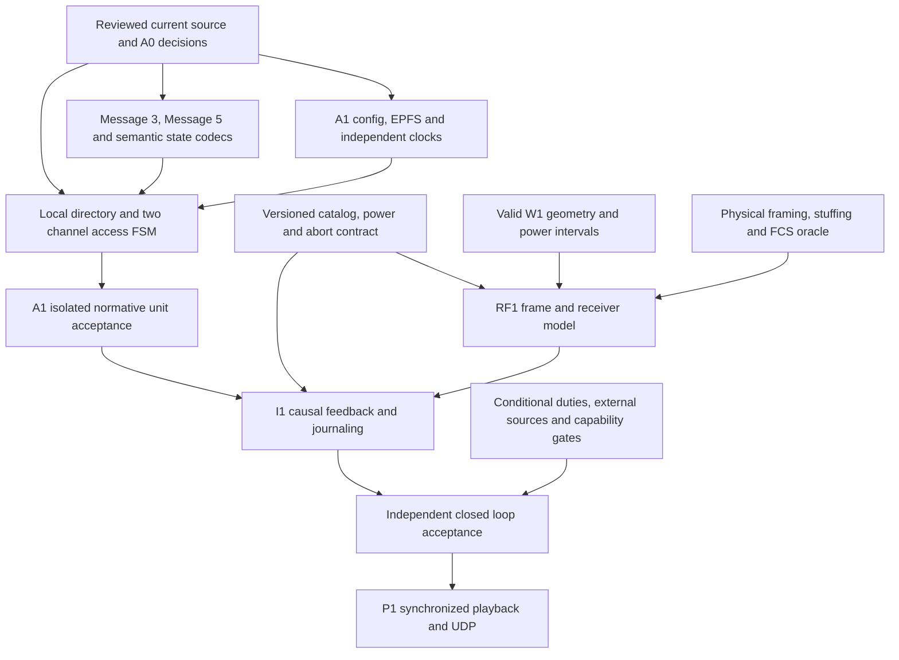

# A0: A1 interface and gap register

Baseline audited: branch `lab`, HEAD `2f4bdfc0a0407916ddbb173dfd8f23c12d55ecb0`. This is a documentation design, with no new callable API, event values, codecs or configuration files. Requirement IDs resolve in [the traceability CSV](A0_REQUIREMENTS_TRACEABILITY.csv); tests resolve in [the test matrix](A0_TEST_MATRIX.md). All proposed interface choices below are `SIMULATION_POLICY`, principally A0-INT-001 through A0-INT-012, rather than ITU API requirements.

**Current sustained Class A pilot: NO-GO.** The repository cannot produce the required initial Message 3 or a complete closed-loop Class A run. A0 specifies the dependencies; it does not resolve them by relabelling existing fixtures. A1 implementation work may begin after the design decisions identified below are reviewed. An A1 unit test with an explicit input fixture is distinct from RF1/I1 radio acceptance.

## Audited repository interfaces

Paths and line numbers describe the baseline, not proposed files. Scope was checked by reading the declarations and relevant implementations.

| Existing symbol and location | Present contract | A1 consequence |
|---|---|---|
| `world::Vessel`, `NavigationStatus`, `VesselState`, `VesselSnapshot`, [world.h](../../world/world.h), lines 42, 49, 106, 136 | Stable vessel/equipment/radio IDs; own navigation status, milli-knot SOG, WGS84 location, optional ground course, equipment power/generation, antenna offset and optional ellipsoid height | Select exactly one own vessel at a timestamp. A station must never receive the whole world snapshot as protocol knowledge. |
| `world::Transition`, `TransitionKind`, `Timeline::advance`, `WorldSession`, [world.h](../../world/world.h), lines 93-105, 147-177 | Independent world evolution and exact power transition notices; flags request later protocol initialization or burst abort | Own navigation continues while AIS is OFF. An ON notice supplies a power epoch, not transmit readiness. |
| `world::receiver_ownership`, [world.h](../../world/world.h), line 181 | Immutable ownership view of one world snapshot | Useful initial catalog input; not a live, durable ownership/power-history version. |
| `world::rf_geometry`, `inspect_burst`, [world.h](../../world/world.h), lines 182-192 | Rejects unresolved absolute RF geometry; reports whether own equipment may start and an OFF before end | A physical constraint, without a transmission, decode or propagation result. Dynamic reach radius never proves reception. |
| `runtime::SimulationInstant`, `UtcAnchor`, `UtcSlot`, [simulation_time.h](../../runtime/simulation_time.h), lines 7-40 | Exact 9,830,400-unit seconds; 262,144-unit slots; 589,824,000-unit frames; explicit POSIX UTC anchor and checked arithmetic | Reuse exact time representation. A station's clock/lock/error/source state remains missing; a UTC anchor is not a GNSS receiver. POSIX leap-second limits remain explicit. |
| `runtime::EventKind`, `TransmissionStart`, `SlotMapChange`, [event.h](../../runtime/event.h), lines 38-66 | Existing stable event codes, station-local channel/slot change, declared TX end and immutable external payload reference | Event text cannot replace a typed protocol state, on-air bit plan or proof of decode. No `TransmissionAbort` kind exists. |
| `runtime::EventValidator`, [event.cpp](../../runtime/event.cpp), lines 394-450 | Rejects station OFF while a TX is open; permits only declared normal TX end; rejects overlapping physical transmissions from one station | Existing validation protects current contracts. It cannot represent W1's mandatory mid-burst power cut. Do not weaken it in A0. |
| `runtime::Scheduler`, [scheduler.h](../../runtime/scheduler.h), lines 17-60 | Canonical causal queue, same-time phase batches, half-open commit watermark, attached producer barriers | It is never a shared slot allocator, collision preventer or global winner authority. |
| `runtime::ReceiverRegistry`, `ReceiverOwnership`, [rf_contract.h](../../runtime/rf_contract.h), lines 64-87 | Immutable bounded catalog of role, owner and enabled state | A live catalog needs additive versions and simulation-time power intervals; ownership cannot be inferred from geography or a text station label. |
| `ReleasedRfObservation`, `LocalRfObservation`, `LocalObservationRouter`, [rf_contract.h](../../runtime/rf_contract.h), lines 102-154; [rf_contract.cpp](../../runtime/rf_contract.cpp), lines 204-225 | Producer-minted, scheduler-dispatched token; router proves own enabled transceiver receiver and availability; filtered input hides global TX ID/remote truth | Preserve this authority boundary. Current local token exposes time, receiver, disposition, causal ID and decoded payload reference, but no channel, RF timing/strength evidence, parsed fields or power-epoch identity. |
| `RfCausalBoundary`, `RfDiscovery`, `RfTransmissionWork`, [rf_contract.h](../../runtime/rf_contract.h), lines 17-24, 93-100, 163-211 | Distinct resolved-before RF horizon and committed event watermark; bounded registered in-flight TX context and final dispositions | Provides causal plumbing, without a physical receiver model, packet validator or fully decoded local station evidence. |
| `CompactRfObservation`, [rf_contract.h](../../runtime/rf_contract.h), lines 213-240 | Explicit 64-byte host/device POD envelope with stable numeric identity bindings | Not a durable file ABI or physical frame schema. Do not silently reinterpret reserved fields. |
| `ais::Type1/4/9/18/21`, `Message`, [ais_message.h](../../ais/ais_message.h), lines 79-190 | Five typed payloads; no Type 2, 3, 5 or 24B | Type 3 is an unconditional startup blocker. Existing Type 4/9/18/21 must retain their base/aircraft/Class B/AtoN roles. |
| `ais::RadioState19/20`, [ais_message.h](../../ais/ais_message.h), lines 45-73 | Explicit range-checked caller-supplied raw state, without allocation/sync inference | A1 owns semantic state construction. A range-valid raw number does not prove a valid announcement. |
| `ais::Type1::low_transmit_power`, [ais_message.h](../../ais/ais_message.h), line 95 | Explicit current-edition transmit-power bit 147 | Already modeled by B3; not a missing field and not evidence that B3 operates a Class A transceiver. |
| `ais::EncodedPayload`, `encode`, [ais_encoder.h](../../ais/ais_encoder.h), lines 11-31 | MSB-first AIS data bits plus six-bit armoring/fill; no radio framing | RF1 requires a separately specified on-air packet representation and independent bit/FCS oracle. |
| `ais::format_aivdm`, `encode_aivdm`, [nmea0183.h](../../ais/nmea0183.h), lines 15-36 | Ordered, checksummed NMEA sentences with CRLF and caller sequence ID | NMEA fragment count and XOR checksum are unrelated to radio slot count and HDLC FCS. P1 uses valid decoded data later. |
| `world::Purpose`, `kRngVersion`, [rng.h](../../world/rng.h), lines 13-24 | Frozen W1 semantic random domains 1-16 | Define a separately versioned protocol domain; retain station-specific draw history independently of launch/worker order. |

## Proposed independent station boundary

The sketch names conceptual records. It neither promises a C++ ABI nor adds structures to existing headers. Field names are review aids. One instance belongs to one stable `(station_id, equipment_id, radio_id)` and power generation. Passive terrestrial receivers have RF/P1 roles and no Class A protocol instance.

| Proposed input | Required content and authority | Invalid or missing case |
|---|---|---|
| `OwnNavigationInput` | Selected own `VesselSnapshot`; exact sample time and world revision; status, SOG, location, optional COG; explicit EPFS fix-generation time/validity/provenance | Foreign vessel, future sample, unavailable position, stale fix or absent EPFS contract is explicit input failure/degraded state. |
| `StationConfig` | Stable equipment/radio identity, explicitly assigned simulation MMSI, static/voyage metadata, antenna reference, protocol version, capability profile, effective seed, UTC policy | Never synthesize MMSI from vector index, name or coordinates. MMSI formatting is not an allocation-authority check. |
| `StationClockInput` | Observation time, source category, validity/accuracy/error/holdover status, UTC-to-simulation mapping revision and local slot phase | No input means no claim of direct UTC synchronization. Clock loss/source changes are decisions/timers, not inferred world events. |
| `OwnRadioEvidence` | A routed own-radio token, exact channel, power/catalog generation, receipt availability, physical interval/timing evidence, decode disposition, immutable payload reference and validated decoded fields only for valid decode | Reject wrong owner/role/generation, future availability, forged token, invalid FCS, absent complete-frame proof or a decoded allocation attached to carrier/failure evidence. |
| `OwnPowerNotice` | Authoritative W1 ON/OFF at simulation T, equipment identity and generation, with coupled own TX/RX power | ON starts initialization. OFF cancels unsent work and routes overlapping physical work to the future abort contract. |
| `LocalTimer` | A timer created by this instance with epoch, purpose, deadline and originating local cause | Reject an old epoch, unknown timer or a timer before its allowed causal frontier. |

A0-INT-001, A0-INT-003, A0-INT-005 and A0-INT-007 apply. The first pilot may explicitly provide valid independent direct UTC and own world truth as valid EPFS input. Record those assumptions per station. They do not supply true heading, turn indicator, RAIM or PA information.

The conceptual operations are `initialize(config, own_inputs)`, `accept_local_input(input, decision_frontier)`, `advance_to_next_local_boundary(frontier)` and `snapshot_state()`. A returned plan contains zero or more **requested** transmissions plus local state deltas. No operation can query another station's state or request its slot map. Invocation of a host function does not establish a successful radio transmission or reception.

| Proposed output | Required content | Consumer |
|---|---|---|
| `TransmissionRequest` | Stable station/equipment/radio/power generation; exact channel; allocated slot block; requested start; payload identity/type/data-bit length; immutable physical-frame-plan identity/version; exact nominal physical start/end; local decision cause and evidence digest | I1 validates power/phase and publishes the actual start; RF1 evaluates actual physical work. |
| `LocalReservationDelta` | Own map/channel/UTC-frame/slot block; state transition; source of knowledge; allocation timeout/last-heard age; causal token or own decision and power epoch | Station state and diagnostic journal adapter. This is knowledge, not a globally exclusive lease. |
| `ProtocolDecision` | Old/new state, trigger, reporting basis, source selection, candidate evidence, access algorithm, semantic RNG draw references and message/channel choice | Reproducibility record and independent oracle; no hidden future RF outcomes. |
| `NextBoundary` | Earliest local timer/power/navigation/clock/expiry/received-evidence boundary that can affect the next decision | Host driver and causal queue. It cannot assert RF results beyond the RF producer's proof. |

RF coverage rosters and remote geometry belong to RF/I1 work preparation, outside the station input envelope. They must not leak back through `TransmissionRequest` acceptance as knowledge of audible peers. An overlapping request from another independent station is a valid protocol outcome; it proceeds to physical RF evaluation (A0-INT-002).

### State needed for deterministic persistence

Persist configuration/content hashes and versions; stable identity/catalog and power generation; own input revisions/fix time; station clock source/phase/quality and discipline history; named FSM substate and initialization deadline; both local channel maps and the local directory with last-heard/timeout/range provenance; pending first-frame announcements and continuous reservations; nominal timing/reporting-change/assignment/quiet timers; queued message priorities/deadlines; channel-selection history; immutable payload/frame plans; semantic RNG episode/draw ledger; and accepted local causal receipt identities. Preserve sufficient causes to explain each reservation and future announcement. This extends no current journal bytes (A0-INT-006, A0-INT-008, A0-INT-009).

OFF clears protocol reservations, directory/observation state and unsent epoch-specific work. Own identity/configuration persists. Regional channel settings have their separate retention/restart rules under A2-4.1.5; do not treat a protocol reset as permission to erase required geographic configuration. Old journaled decodes retain their historical validity for playback, even when they cannot become new-epoch station knowledge.

## W1-to-report mapping and missing inputs

Requirements A0-MSG-002 through A0-MSG-008 and A0-INT-007 govern this mapping. Quantization/rounding is an explicit A1 conversion decision to be reviewed and tested, not inferred from the world field type.

| Needed Class A information | Actual W1 availability | Resolution for A1 |
|---|---|---|
| Navigation status | Enum values 0, 1, 3 only | Map these actual meanings. Additional states, including moored, need explicit input/configuration; do not translate stationary automatically into moored. |
| SOG | `speed_mkn`, nominal speed and restricted speed cap | Convert milli-knots to field tenths and use actual speed/status for reporting. Define quantization with edge tests. Zero speed is not an unavailable-speed code. |
| WGS84 position | Snapshot location and time | Explicit own-truth-to-EPFS pilot assumption plus fix timestamp/validity; do not claim a physical GNSS model. |
| COG | Optional `course_ndeg` | Convert only when valid. A stationary vessel can lack COG. |
| True heading | Absent | New own sensor/config input, or specified unavailable heading 511. Do not use COG as heading. Anchor-dragging cadence cannot silently presume heading. |
| ROT | Absent | New turn-indicator input, or unavailable -128. Table 46 expressly excludes deriving ROT from COG. Reporting-course change detection is a separate question. |
| PA/RAIM/correction/error | Absent | Explicit future EPFS integrity input. Apply Table 48; do not claim high accuracy from deterministic coordinates. |
| MMSI | Typed codec accepts a valid digit string; W1 has no per-vessel MMSI | Required explicit station configuration and documented synthetic identity policy. Allocation legitimacy remains external to B3 syntax validation. |
| EPFS fix generation time and validity | Snapshot time is present, sensor fix time/mode is absent | Explicit input association and freshness policy. AIS timestamp refers to fix generation, not later NMEA playback. |
| Direct/indirect UTC, clock error, holdover/source | Runtime has exact common time and anchor only | Separate station clock input and state, even under direct-UTC pilot assumption. Clock degradation needs its own state. |
| Static/voyage fields | Name and antenna mounting exist; no full call sign, ship type, dimensions/reference point, IMO/flag number, draught, ETA, destination or DTE | New A1 configuration; use prescribed unavailable values only where permitted and explicit. Vessel name is not proof of licensed name. Antenna height does not supply A/B/C/D dimensions. |
| Message 24B manufacturer/model/serial | Absent | Separate explicit metadata/capability; required deadline gate for sustained Class A pilot. |
| Radio channel management, assignments, quiet times | Absent | Separate locally decoded command state with applicability, lifetime and precedence. Deferred features remain declared. |
| Antenna absolute geometry | Offset plus optional explicit waterline ellipsoid height; passive elevation may be AMSL | Require documented datum/conversion before ECEF RF work. Never assume sea level equals WGS84 ellipsoid. |

## Existing causal event and phase mapping

This table is a literal inventory of `causal_phase` in `lab/runtime/event.cpp:159`, not a proposal to reorder it. Existing code values are frozen journal values. The `StreamingV2` validation profile is opt-in; its existence does not create a new abort kind.

| Phase | Existing EventKind codes | A1/I1 meaning and remaining work |
|---|---|---|
| 0 | `StationOn` 1, `StationOff` 2, `ReceiverOn` 3, `ReceiverOff` 4 | Publish world equipment/radio lifecycle. A typed epoch/catalog/clock association is missing. OFF cannot presently close active TX. |
| 1 | `TransmissionEnd` 11, `RfObservation` 12 | Normal declared completion and undecoded/carrier evidence. No partial/aborted-frame completion. |
| 2 | `ReceptionSuccess` 13, `ReceptionFailure` 14, `RfNoReception` 17 | Trusted physical-model dispositions, never station-invented receive success. Local routing still requires publication and ownership proof. |
| 3 | `SlotMapInit` 5, `SlotMapReset` 6, `SlotReserve` 7, `SlotRelease` 8, `TdmaDecision` 9 | Journal own knowledge/decision effects. Same-phase entries at one instant cannot be causal parents of one another, even if canonical sort displays one first. |
| 4 | `TransmissionStart` 10 | Publish all simultaneous starts as a coherent phase group; no ordering-based carrier foreknowledge or global winner. |
| 5 | `ReceiverNmea` 15, `OutputError` 16, `ReceptionNoOutput` 18 | Output after a proved decoded reception, or explicit lack of output. Later wall-clock playback is separate. |
| 6 | `TransmissionResolved` 19 | Correlation retirement/final-disposition bookkeeping, not physical frame completion or a new source of station knowledge. |

At one instant, phase-2 locally delivered reception may cause phase-3 decision and then phase-4 TX start, if all physical availability and producer-barrier constraints are satisfied. A phase-3 `SlotReserve` cannot be followed at that same instant by a phase-3 `TdmaDecision` citing it as cause. Use an earlier existing cause, a coherent decision/result record, or a separately reviewed additive model; do not assign a one-unit artificial delay merely to satisfy a validator. Clock changes/timer firings have no typed EventKind today. Their publication/causal anchors require an explicit design (A0-GAP-012).

### Power-off and completion conflict

For an actual physical burst `[start, nominal_end)`, W1 OFF at T with `start < T < nominal_end` truncates interference at T and prevents full-frame decode. It does not create a successful normal `TransmissionEnd`. Existing normal end validation requires its time to equal the start's declared end. Existing station OFF validation rejects an open TX before that end. Even `T == nominal_end` needs formal treatment: phase-0 lifecycle is ordered before phase-1 normal end, so the half-open physical boundary alone does not make the existing validator accept the record sequence. RX-off/complete-frame ties also need a reviewed simulation-time interpretation.

A future additive contract must carry original nominal interval, actual end/cutoff, power generation, abort cause, partial-frame validity and terminal per-receiver dispositions; choose and validate its lifecycle/abort/completion phases together. Retain all original schema versions and goldens. A0 creates no kind number, no abort bytes and no exception to existing validators (A0-INT-004).

## Dependency and gap register

`BLOCKING` means required before the stated acceptance claim; it is not an assertion that A0 must implement it. There are **12 unconditional implementation dependencies** (001-012) for the intended sustained closed-loop pilot, **6 conditional capability dependencies** (013-018), **4 open interpretation/external-reference review entries** (019-022), and **1 blocking source-adjudication entry** (023) grouping seven access-rule questions. A short A1 algorithm fixture may exercise a subset, with that limit recorded. None is closed by a mock `ReceptionSuccess`.

| Gap ID | Severity / claim blocked | Evidence and required closure | Owning phase / tests |
|---|---|---|---|
| A0-GAP-001 | BLOCKING: any normative first emission | Type 3 codec absent; implement and independently bit-check Message 3 with the current 168-bit layout and ITDMA state. Type 1 cannot substitute. A0-MSG-001/002. | A1; A0-T03, A0-T10, A0-T17 |
| A0-GAP-002 | BLOCKING: sustained static/voyage obligations | Type 5 absent; explicit metadata, due/amended/request handling, two-slot scheduling and frame construction needed. Short fixture deferral must end before a due obligation and cannot claim full Class A operation. A0-MSG-007/008/011. | A1/I1; A0-T17, A0-T31, A0-T33 |
| A0-GAP-003 | BLOCKING: valid report identity/data | W1 lacks MMSI and full own EPFS/heading/ROT/RAIM/static configuration. Add explicit inputs and unavailable-field decisions; resolve Table 1 dependencies without fabrication. A0-MSG-003..008. | A1; A0-T11, A0-T14, A0-T33 |
| A0-GAP-004 | BLOCKING: clock/slot synchronization | Exact simulation time lacks independent clock source/discipline/validity. Specify direct-UTC pilot inputs and degraded-state transitions. | A1; A0-T01, A0-T05, A0-T14 |
| A0-GAP-005 | BLOCKING: protocol decisions | No Class A FSM/directory/channel maps/RATDMA/ITDMA/SOTDMA engine. Implement actual one-minute startup and first-frame sequence with independent normative oracles. | A1; A0-T01..A0-T11 |
| A0-GAP-006 | BLOCKING: meaningful local RF feedback | Local token lacks channel, RF timing/strength, power generation, parsed packet/state and complete-frame/FCS evidence. Add an owned evidence view and validated packet resolver without global-journal access. | A1/RF1/I1; A0-T04, A0-T06, A0-T07, A0-T31 |
| A0-GAP-007 | BLOCKING: on-air validity | Payload bits/armoring lack HDLC framing, stuffing, FCS, packet-length plan and exact RF-active interval. Specify distinct immutable frame identities and independent decode oracle. | RF1/I1; A0-T13, A0-T17, A0-T31 |
| A0-GAP-008 | BLOCKING: W1 power integration | No abort kind/version; normal end and lifecycle validators conflict with a mid-frame OFF and an exact-end tie. Add reviewed, versioned physical abort/power/disposition semantics without weakening old profiles. | RF1/I1; A0-T02, A0-T13, A0-T31, A0-T32 |
| A0-GAP-009 | BLOCKING: live ownership/deterministic replay | Immutable snapshot catalog lacks durable versioned station/equipment/radio/receiver ownership and lifecycle history. Bind evidence to simulation-time power epochs. | I1/P1; A0-T02, A0-T15, A0-T32 |
| A0-GAP-010 | BLOCKING: production physical receive claim | No production frame-level CUDA RF model or complete geometry/datum contract. Evaluate per-receiver interference/capture/complete frame/FCS with actual power intervals. W1 radius cannot be a success oracle. | RF1; A0-T04, A0-T07, A0-T12, A0-T13, A0-T31 |
| A0-GAP-011 | BLOCKING: reproducible independent protocol randomness | Protocol purpose/version/draw ledger absent. Define a new namespace independent of W1 1-16 and of any global worker cursor. | A1/I1; A0-T08, A0-T09, A0-T15, A0-T16 |
| A0-GAP-012 | BLOCKING: causal closed-loop integration | Host driver, typed clock/timer causes, boundary batching and producer proofs are not implemented. Specify same-phase causes and local decision frontier; no full-run open-loop slot precomputation. | I1; A0-T04, A0-T06, A0-T11, A0-T15 |
| A0-GAP-013 | CONDITIONAL BLOCKING: assigned/polled operation | Type 2, incoming Message 15/16/20/22/23 decoding/commands, Message 11 UTC response and applicable reply/safety queues need explicit support. Declare unsupported stimuli for the initial autonomous pilot. | A1/I1; A0-T18, A0-T35 |
| A0-GAP-014 | CONDITIONAL BLOCKING: pilot reaching 12 min / full Class A | Message 24B and manufacturer metadata absent. A7-3.22, printed 140, requires first output within 12 min and every 24 h thereafter; Class A interrogation returns Manufacturer-ID-only Part B. A0-MSG-015. | A1/I1; A0-T18, A0-T34, A0-T35 |
| A0-GAP-015 | CONDITIONAL BLOCKING: full Class A / satellite capability | Annex 3 long-range Message 27, MSSA and channels 75/76 absent. AIS1/AIS2-only pilot must declare limited coverage, not complete Class A conformity. | A1/RF1/I1; A0-T18, A0-T35 |
| A0-GAP-016 | CONDITIONAL BLOCKING: degraded/indirect clock or position | Base/semaphore source selection, loss-of-position behavior and indirect synchronization need explicit inputs, state and test oracles beyond direct-UTC pilot. | A1/I1; A0-T14, A0-T18 |
| A0-GAP-017 | CONDITIONAL BLOCKING: application/safety traffic | Binary/safety/ack/retransmission duties and application identifiers require per-message capability, priority, slot and deadline handling. Unsupported traffic must not be forged. A0-MSG-018. | A1/I1; A0-T18, A0-T31, A0-T35 |
| A0-GAP-018 | CONDITIONAL BLOCKING: synchronized playback/UDP claim | Current playback/output infrastructure is not P1 acceptance of multi-receiver radio journals. Define durable per-receiver decoded-frame identity and wall-time scheduling/output behavior. | P1; A0-T15, A0-T32 |
| A0-GAP-019 | OPEN interpretation: rounding and boundary details | Review Table1 speed edges, angular wrap and missing-heading anchor conditions; Table16 NI/SI rounding/limits; candidate wrap/exhaustion; staggered-channel/low-rate first-frame origin and terminal-zero timing (A0-ISS-003); no-UTC timeout1 encoding (A0-ISS-004). Any unproved convention stays policy or conflict. | A0/A1 review; A0-T05, A0-T08, A0-T09, A0-T11, A0-T14, A0-T19 |
| A0-GAP-020 | OPEN interpretation: completion/availability ties | Define RX OFF exactly at signal end, reservations expiring at a boundary, ON at a slot boundary and same-phase local changes under the current causal model. No ITU claim for project event ordering. | A0/I1 review; A0-T01, A0-T02, A0-T06, A0-T13, A0-T15 |
| A0-GAP-021 | EXTERNAL_REFERENCE_REQUIRED | Identity allocation, IEC sensor/presentation interface behavior, applicable IEC conformance/testing, IMO/flag number authority, manufacturer mnemonic allocation, DGNSS and IALA application details require their actual authoritative editions. M.1371 cross-references do not establish that they were read. | Before corresponding full conformance claims; A0-T18, A0-T33, A0-T35 |
| A0-GAP-022 | OPEN review limit: edition-comparison scope | Current M.1371-6 payload rules are audited against B3. The acceptance log separately records a targeted 2014 comparison; this is not a complete clause-by-clause edition change audit. Do not describe old ITDMA features as new without evidence. | A0 review; A0-T17, A0-T33, A0-T34 |
| A0-GAP-023 | BLOCKING: normative A1 source/oracle freeze | A0-MAC-035..041 retain seven current-source issues: NI bound, RATDMA comparator, duplicate timeout decrement, low-rate threshold, fractional slot conversion, adjacency wording and Table14 numeric/PDF-Word discrepancies. Their exact printed locations and competing readings are in the specification/CSV. Obtain authoritative clarification or declare a versioned limited policy and exclude disputed normative acceptance; do not silently choose a convenient algorithm. | A0/A1 review; A0-T19, plus affected A0-T05/08/09/10/11 |

Message 24B is a conditional-duration blocker even in an otherwise base-free autonomous topology. A five-hour experiment reaches its initial deadline. Type 5 is not optional merely because the current codec lacks it. A diagnostic first-emission unit fixture can focus on startup, but its result is limited to that fixture. Full normative Class A capability additionally requires all applicable conditional duties and external references. ISO/IEC13239:2002 exact CRC/serialization detail and an independent wire oracle remain EXTERNAL_REFERENCE_REQUIRED under gaps007/021; RF tail thresholds and non-integral1ms timing need a reviewed RF1 profile as A0-TIM-004 describes.

## Handoffs and additive version boundaries

| Handoff | Stable semantics to retain | Explicit future additive version or decision |
|---|---|---|
| W1 -> A1 | Own navigation only; exact world time; stable IDs; coupled own TX/RX power | EPFS input provenance, own clock, missing sensor/config fields and power-epoch envelope |
| A1 -> I1/RF1 | Independent station decisions, channel, physical intent, causal origin, immutable identities | Typed frame plan, actual TX disposition/abort, physical timing, catalog/power revisions |
| RF1 -> A1 via I1 | Ownership-filtered dispatched token, availability, no global TX truth | Channel/timing/energy/FCS/validated decoded bits and state; physical epoch proof |
| I1 -> durable journal | Canonical causal order, injective producer IDs, separate RF horizon and event watermark | Typed catalogs/checkpoints, clock/timer records, aborted frame and decoded-frame schema; migration plan preserving journal-v1/StreamingV2 goldens |
| Decoded data -> P1 | Simulation-time valid decode and exact receiver identity | Synchronized multi-receiver wall-time playback and UDP integration; original RF validity cannot depend on later equipment state |

An additive in-memory interface can preserve old event/file formats while A1 unit work proceeds. Acceptance of W1 power cuts and durable replay still requires a formal new contract; a new wrapper cannot repair missing semantics by changing `detail` text. A0 does not renumber EventKind, change POD layout, alter old journal records or touch golden files.

## Dependency graph and release decisions

The graph is a dependency relation, not a centralized TDMA flow. At run time, each host station reacts to its own navigation/clock/radio/timers; all simultaneous starts are passed to RF1. CUDA batches can scale RF evaluation without becoming a shared station decision oracle.

| Acceptance claim | Current decision | Required evidence for GO |
|---|---|---|
| A0 documentation ready for operator review | Reviewable with the explicit gaps above; not implementation acceptance | Cross-file traceability, source/page spot checks, documented source-read limits and scope/whitespace verification in the acceptance file |
| A1 design decisions ready to freeze | NO-GO while applicable interpretation/input/version choices remain open | Operator/reviewer decisions for critical clock/reporting/rounding/power/publication boundaries and a named capability profile |
| Genuine first Class A emission | NO-GO | One-minute observation, no premature TX, proper RATDMA entry, Message 3 with validated ITDMA state and complete physical frame; Type 1 shortcut fails |
| A1 protocol-only unit acceptance | NOT IMPLEMENTED / NOT RUN | Independent fixtures for the required FSM/access/message decisions, with explicit fixture RF/clock authority and no claim of production propagation |
| Sustained AIS1/AIS2 closed-loop pilot | NO-GO | Unconditional gaps 001-012 closed; due Message 5 and Message 24B duties handled; all applicable conditional limits declared and tested |
| Full Class A compliance | NO-GO | Applicable satellite, command, degraded, safety/transport and externally referenced requirements included and independently qualified |
| Production RF1/I1/P1 radio/playback acceptance | NO-GO | Actual physical model and integration/playback evidence; no synthetic successes, radius oracle, global slot allocator or fabricated performance |

**Build, CTest, historical regression suites and every future A1/RF1/I1/P1 test described here: NOT RUN.** Only documentation-integrity checks are appropriate to A0. No implementation or radio-performance result is asserted.
