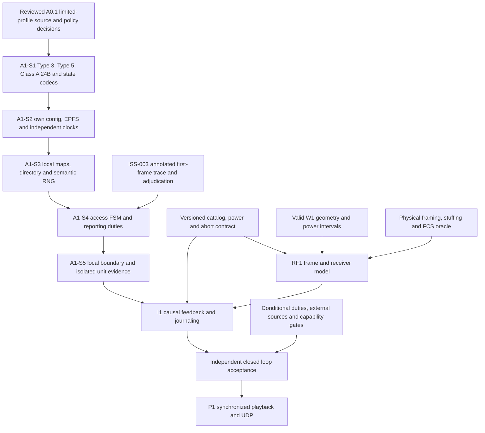

# A0: A1 interface and gap register

Original A0 repository audit: branch `lab`, HEAD `2f4bdfc0a0407916ddbb173dfd8f23c12d55ecb0`. A0.1 correction baseline: `964c2a149d1de2fae128c1c6d950cce3622b3d20`, reviewed on 2026-10-19. The original implementation inventory below remains applicable; A0.1 changes documents only. This is a documentation design, with no new callable API, event values, codecs or configuration files. Requirement IDs resolve in [the traceability CSV](A0_REQUIREMENTS_TRACEABILITY.csv); tests resolve in [the test matrix](A0_TEST_MATRIX.md). All proposed interface choices below are `SIMULATION_POLICY`, principally A0-INT-001 through A0-INT-012, rather than ITU API requirements.

**D1: CONDITIONAL GO for isolated A1-S1 coding under `LCP-CLASSA-AUTO-TERR-v1`; D2: NO-GO for a sustained five-hour RF-closed-loop UDP pilot.** D0 documentation GO depends on the integrity and scope checks recorded in [review and acceptance](A0_REVIEW_AND_ACCEPTANCE.md). The repository still cannot produce the required initial Message 3 or a complete closed-loop Class A run. The reviewed limited-profile decisions permit staged engineering; they do not close implementation dependencies. An A1 unit test with an explicit input fixture is distinct from RF1/I1 radio acceptance. Full ITU/IEC Class A conformity is not claimed.

## A0.1 limited capability boundary

`LCP-CLASSA-AUTO-TERR-v1` is the versioned first-pilot and A1-unit feature boundary. Its eight decision records `LCP-P01` through `LCP-P08` and their source/policy distinctions are authoritative in [the normative specification](A0_NORMATIVE_CLASS_A_SPEC.md). A0-SIM-009 through A0-SIM-016 bind those decisions respectively. They are not ITU errata or type approval. Source-derived readings A0-MAC-035/036/037/039/040 retain the published contradictions; A0-MAC-041 retains the actual Table 14 numeric conflict, with the false PDF/Word sign disagreement removed. A0-MAC-038/A0-RF-016 retain the unresolved low-rate assignment threshold conflict.

| Profile element | Frozen design boundary / authority |
|---|---|
| Topology | Two independently configured and powered Class A transceivers, each with one physical TX and two simultaneous terrestrial channel RX processes. AIS1 161.975 MHz and AIS2 162.025 MHz only. The first UDP acceptance designates one independent passive terrestrial receiver and its receiver-specific stream; any additional receivers remain independent. Passive RX has no Class A network-entry or reservation FSM. |
| Own inputs | A station sees its own W1 navigation, explicit clock/configuration/timers and causally delivered ownership-proved own-radio decodes/energy only. Foreign W1 positions, global RF journals and another station's maps are unavailable to its decision engine. |
| Clock and EPFS assumptions | Each station receives an explicit IDEAL independent direct-UTC input with its own source identity, validity, local time/phase and provenance. The own-truth EPFS adapter explicitly sets fix-generation time to the sampled own W1 snapshot time and supplies validity/provenance. Neither adapter claims real GNSS hardware, measured accuracy, RAIM, heading or ROT. A common `SimulationInstant`/`UtcAnchor` alone supplies neither adapter. Prescribed unavailable values and resulting reporting restrictions remain applicable. |
| Identity and traffic | Explicit stable unique nine-decimal-digit syntax-valid synthetic MMSIs belong in per-station configuration; no vector-index derivation or regulatory-assignment claim. Eventual UDP output requires operator-approved loopback/isolated endpoints and synthetic-traffic labelling. No real AIS RF transmission is authorized. |
| Access and messages | Every ON starts 60 s observation; special Message 3/ITDMA entry and actual first-frame operation precede continuous per-channel SOTDMA. Two local maps, local reuse/candidates, non-entry RATDMA, priorities/FIFO and channel alternation apply. Table 1 reporting/hysteresis and ordinary anchored 1/3-report/min ITDMA remain in scope. Required payload coverage is Type 1 (existing), Type 3, Type 5 and Class A Type 24B as applicable; Type 5 needs two-slot physical framing at RF1. |
| Independent decisions | Seeded station decisions and draw histories are independent of peer actor order/count and workers. Simultaneous independent TX requests may overlap; only future per-receiver RF1 evidence determines the physical outcome. `LCP-P08` defines a separate semantic Philox namespace without changing W1 purpose IDs 1-16. |
| Explicit exclusions | No full Class A certification, real oscillator/GNSS performance, satellite Message 27/MSSA/channels 75/76, assigned/polled/command modes, base/indirect UTC, repeater, regional channel management, silent control, safety/binary/acknowledged transport or general IEC presentation acceptance. Stimuli activating unsupported obligations must be rejected/deferred by capability rather than accepted as conformance success. Type 2 and Message 24A are optional future codecs and are not A1-S1 gates. Existing Type 4/9/18/21 are not new Class A pilot requirements. |
| Acceptance boundary | A0.1 supplies no RF decode, interference/FCS packet, NMEA/UDP traffic or production closed loop. Isolated A1 units establish deterministic payload/decision behavior only. Fixture observations remain explicitly fixture-only; a production input boundary rejects mocked/foreign/future evidence. |

The below-both-thresholds anchored rate is justified ITDMA within this profile; Message 23 assignment and the disputed assignment-rate interval [1,2) reports/min are excluded. The Table 16 fractional/assigned NI cases remain unresolved outside `LCP-P01`. A0-ISS-003 remains pilot-critical: staggered-channel first-frame origins and low-rate terminal-zero interpretation require an annotated independent trace and operator/reviewer adjudication. Affected A1-S4 FSM freeze/acceptance is NO-GO until that review; the A0.1 boundary and eight scoped decisions do not invent its answer. No-UTC timeout-1 interpretation A0-ISS-004 is outside the ideal-direct-UTC profile. Neither issue prevents isolated A1-S1 codec work.

### Future demonstration duration and datum manifest

The historical W1 demo remains unchanged: `online_duration_seconds [100,1000]`, `offline_duration_seconds [10,300]`, `initial_delay_seconds [0,10]`, unresolved vessel waterline ellipsoid heights and passive sites that can use AMSL. Short ON episodes can stop before first-frame completion; longer episodes may reach continuous SOTDMA. These ranges do not prove continuous operation impossible or rare. No YAML, digest, golden or geometry implementation is changed here.

Specify a future separate versioned long-ON fixture with guaranteed ON spans of at least 30 minutes and varied OFF spans, using W1-valid bounded intervals and recording exact seed/configuration/provenance. An optional separately controlled five-hour continuously ON fixture can provide sustained evidence. Five hours means simulation time; no elapsed-time or experimental result is asserted. Its manifest must identify each station's power epoch, intended request, actual start/completion/abort and due/missed/blocked duties independently.

| Future manifest field | Required later acceptance evidence |
|---|---|
| Capability and excluded stimuli | Exact profile/policy versions, message coverage, unavailable inputs and any commands/conditional duties prohibited by this fixture. |
| Duration/deadlines | Type 5 six-minute duties and the first Class A 24B ON+12-minute deadline occur within five hours; the 24-hour recurrence is not reached. `LCP-P07` uses OFF->ON as the equipment-epoch anchor, queues applicable first messages after the actual first-frame phase at lawful opportunities, and distinguishes conservative Type 5 first-due policy from the normative 24B startup deadline. Amendment/request triggers remain explicit. |
| Early OFF or blocked opportunity | Record operating/eligible intervals, cancelled epoch work and due/missed/blocked state. No legal opportunity means no forced TX, no declared successful physical TX and no shifted deadline. Never move 24B due to 12 minutes after first-frame completion or backfill an OFF period. Frequent short ON episodes require applicability/lifecycle evidence rather than a categorical nonconformance label for powered-off equipment. A1 requests alone prove no on-air completion. |
| RF geometry/datum | Explicitly documented SYNTHETIC WGS84 ellipsoid waterline/site heights, or an independently justified geoid/tide conversion with provenance, before RF1. Above-waterline antenna offset is not absolute ellipsoid height; AMSL is not implicitly WGS84. Synthetic inputs must not be described as surveyed Varna/Balchik geometry. |
| Independent pass criteria | Repeated Type 5/initial 24B physical evidence, valid per-receiver FCS/complete frames, local-only station decisions, source/power ownership, interrupted-frame semantics and receiver-specific playback/UDP outcomes. RF1/I1/P1 acceptance remains required. |

## Audited repository interfaces

Paths and line numbers describe the baseline, not proposed files. Scope was checked by reading the declarations and relevant implementations.

| Existing symbol and location | Present contract | A1 consequence |
|---|---|---|
| `world::Vessel`, `NavigationStatus`, `VesselState`, `VesselSnapshot`, [world.h](../../world/world.h), lines 42, 49, 106, 136 | Stable vessel/equipment/radio IDs; own navigation status, milli-knot SOG, WGS84 location, optional ground course, equipment power/generation, antenna offset and optional ellipsoid height | Select exactly one own vessel at a timestamp. A station must never receive the whole world snapshot as protocol knowledge. |
| `world::Transition`, `TransitionKind`, `Timeline::advance`, `WorldSession`, [world.h](../../world/world.h), lines 93-105, 147-177 | Independent world evolution and exact power transition notices; flags request later protocol initialization or burst abort | Own navigation continues while AIS is OFF. An ON notice supplies a power epoch, not transmit readiness. |
| `world::receiver_ownership`, [world.h](../../world/world.h), line 181 | Immutable ownership view of one world snapshot | Useful initial catalog input; not a live, durable ownership/power-history version. |
| `world::rf_geometry`, `inspect_burst`, [world.h](../../world/world.h), lines 182-192 | Rejects unresolved absolute RF geometry; reports whether own equipment may start and an OFF before end | A physical constraint, without a transmission, decode or propagation result. Dynamic reach radius never proves reception. |
| `runtime::SimulationInstant`, `UtcAnchor`, `UtcSlot`, [simulation_time.h](../../runtime/simulation_time.h), lines 7-40 | Exact 9,830,400-unit seconds; 262,144-unit slots; 589,824,000-unit frames; explicit POSIX UTC anchor and checked arithmetic | Reuse exact time representation. A station's clock/lock/error/source state remains missing; a UTC anchor is not a GNSS receiver. POSIX leap-second limits remain explicit. |
| `runtime::EventKind`, `TransmissionStart`, `SlotMapChange`, [event.h](../../runtime/event.h), lines 38-66 | Existing stable event codes, station-local channel/slot change, declared TX end and immutable external payload reference | Event text cannot replace a typed protocol state, on-air bit plan or proof of decode. No `TransmissionAbort` kind exists. |
| `runtime::EventValidator`, [event.cpp](../../runtime/event.cpp), lines 394-450 | Rejects station OFF while a TX is open; permits only declared normal TX end; rejects overlapping physical transmissions from one station | Existing validation protects current contracts. It cannot represent W1's mandatory mid-burst power cut. Do not weaken it in A0. |
| `runtime::Scheduler`, [scheduler.h](../../runtime/scheduler.h), lines 17-60 | Canonical causal queue, same-time phase batches, half-open commit watermark, attached producer barriers | It is never a shared slot allocator, collision preventer or global winner authority. |
| `runtime::ReceiverRegistry`, `ReceiverOwnership`, [rf_contract.h](../../runtime/rf_contract.h), lines 64-87 | Immutable bounded catalog of role, owner and enabled state | A live catalog needs additive versions and simulation-time power intervals; ownership cannot be inferred from geography or a text station label. |
| `ReleasedRfObservation`, `LocalRfObservation`, `LocalObservationRouter`, [rf_contract.h](../../runtime/rf_contract.h), lines 102-154; [rf_contract.cpp](../../runtime/rf_contract.cpp), lines 204-225 | Producer-minted, scheduler-dispatched token; router proves own enabled transceiver receiver and availability; filtered input hides global TX ID/remote truth | Preserve this authority boundary. Current local token exposes time, receiver, disposition, causal ID and decoded payload reference, but no channel, RF timing/strength evidence, parsed fields or power-epoch identity. |
| `RfCausalBoundary`, `RfDiscovery`, `RfTransmissionWork`, [rf_contract.h](../../runtime/rf_contract.h), lines 17-24, 93-100, 163-211 | Distinct resolved-before RF horizon and committed event watermark; bounded registered in-flight TX context and final dispositions | Provides causal plumbing, without a physical receiver model, packet validator or fully decoded local station evidence. |
| `CompactRfObservation`, [rf_contract.h](../../runtime/rf_contract.h), lines 213-240 | Explicit 64-byte host/device POD envelope with stable numeric identity bindings | Not a durable file ABI or physical frame schema. Do not silently reinterpret reserved fields. |
| `ais::Type1/4/9/18/21`, `Message`, [ais_message.h](../../ais/ais_message.h), lines 79-190 | Five typed payloads; no Type 2, 3, 5 or 24B | Type 3 is an unconditional startup blocker. Existing Type 4/9/18/21 must retain their base/aircraft/Class B/AtoN roles. |
| `ais::RadioState19/20`, [ais_message.h](../../ais/ais_message.h), lines 45-73 | Explicit range-checked caller-supplied raw state, without allocation/sync inference | A1 owns semantic state construction. A range-valid raw number does not prove a valid announcement. |
| `ais::Type1::low_transmit_power`, [ais_message.h](../../ais/ais_message.h), line 95 | Explicit current-edition transmit-power bit 147 | Already modeled by B3; not a missing field and not evidence that B3 operates a Class A transceiver. |
| `ais::EncodedPayload`, `encode`, [ais_encoder.h](../../ais/ais_encoder.h), lines 11-31 | MSB-first AIS data bits plus six-bit armoring/fill; no radio framing | RF1 requires a separately specified on-air packet representation and independent bit/FCS oracle. |
| `ais::format_aivdm`, `encode_aivdm`, [nmea0183.h](../../ais/nmea0183.h), lines 15-36 | Ordered, checksummed NMEA sentences with CRLF and caller sequence ID | NMEA fragment count and XOR checksum are unrelated to radio slot count and HDLC FCS. P1 uses valid decoded data later. |
| `world::Purpose`, `kRngVersion`, [rng.h](../../world/rng.h), lines 13-24 | Frozen W1 semantic random domains 1-16 | Define a separately versioned protocol domain; retain station-specific draw history independently of launch/worker order. |

## Proposed independent station boundary

The sketch names conceptual records. It neither promises a C++ ABI nor adds structures to existing headers. Field names are review aids. One instance belongs to one stable `(station_id, equipment_id, radio_id)` and power generation. Passive terrestrial receivers have RF/P1 roles and no Class A protocol instance.

| Proposed input | Required content and authority | Invalid or missing case |
|---|---|---|
| `OwnNavigationInput` | Selected own `VesselSnapshot`; exact sample time and world revision; status, SOG, location, optional COG; explicit EPFS fix-generation time/validity/provenance | Foreign vessel, future sample, unavailable position, stale fix or absent EPFS contract is explicit input failure/degraded state. |
| `StationConfig` | Stable equipment/radio identity, explicitly configured unique synthetic simulation MMSI, static/voyage metadata, antenna reference, protocol version, capability profile, effective seed, UTC policy | Never synthesize MMSI from vector index, name or coordinates. MMSI formatting is not an allocation-authority check. |
| `StationClockInput` | Observation time, source category, validity/accuracy/error/holdover status, UTC-to-simulation mapping revision and local slot phase | No input means no claim of direct UTC synchronization. Clock loss/source changes are decisions/timers, not inferred world events. |
| `OwnRadioEvidence` | A routed own-radio token, exact channel, power/catalog generation, receipt availability, physical interval/timing evidence, decode disposition, immutable payload reference and validated decoded fields only for valid decode | Reject wrong owner/role/generation, future availability, forged token, invalid FCS, absent complete-frame proof or a decoded allocation attached to carrier/failure evidence. |
| `OwnPowerNotice` | Authoritative W1 ON/OFF at simulation T, equipment identity and generation, with coupled own TX/RX power | ON starts initialization. OFF cancels unsent work and routes overlapping physical work to the future abort contract. |
| `LocalTimer` | A timer created by this instance with epoch, purpose, deadline and originating local cause | Reject an old epoch, unknown timer or a timer before its allowed causal frontier. |

A0-INT-001, A0-INT-003, A0-INT-005 and A0-INT-007 apply. The first pilot may explicitly provide valid independent direct UTC and own world truth as valid EPFS input. Record those assumptions per station. They do not supply true heading, turn indicator, RAIM or PA information.

The conceptual operations are `initialize(config, own_inputs)`, `accept_local_input(input, decision_frontier)`, `advance_to_next_local_boundary(frontier)` and `snapshot_state()`. A returned plan contains zero or more **requested** transmissions plus local state deltas. No operation can query another station's state or request its slot map. Invocation of a host function does not establish a successful radio transmission or reception.

| Proposed output | Required content | Consumer |
|---|---|---|
| `TransmissionRequest` | Stable station/equipment/radio/power generation; exact channel; allocated slot block; requested start; payload identity/type/data-bit length; immutable physical-frame-plan identity/version; exact nominal physical start/end; local decision cause and evidence digest | I1 validates power/phase and publishes the actual start; RF1 evaluates actual physical work. |
| `LocalReservationDelta` | Own map/channel/UTC-frame/slot block; state transition; source of knowledge; allocation timeout/last-heard age; causal token or own decision and power epoch | Station state and diagnostic journal adapter. This is knowledge, not a globally exclusive lease. |
| `ProtocolDecision` | Old/new state, trigger, reporting basis, source selection, candidate evidence, access algorithm, semantic RNG draw references and message/channel choice | Reproducibility record and independent oracle; no hidden future RF outcomes. |
| `NextBoundary` | Earliest local timer/power/navigation/clock/expiry/received-evidence boundary that can affect the next decision | Host driver and causal queue. It cannot assert RF results beyond the RF producer's proof. |

RF coverage rosters and remote geometry belong to RF/I1 work preparation, outside the station input envelope. They must not leak back through `TransmissionRequest` acceptance as knowledge of audible peers. An overlapping request from another independent station is a valid protocol outcome; it proceeds to physical RF evaluation (A0-INT-002).

### State needed for deterministic persistence

Persist configuration/content hashes and versions; stable identity/catalog and power generation; own input revisions/fix time; station clock source/phase/quality and discipline history; named FSM substate and initialization deadline; both local channel maps and the local directory with last-heard/timeout/range provenance; pending first-frame announcements and continuous reservations; nominal timing/reporting-change/assignment/quiet timers; queued message priorities/deadlines; channel-selection history; immutable payload/frame plans; semantic RNG episode/draw ledger; and accepted local causal receipt identities. Preserve sufficient causes to explain each reservation and future announcement. This extends no current journal bytes (A0-INT-006, A0-INT-008, A0-INT-009).

OFF clears protocol reservations, directory/observation state and unsent epoch-specific work. Own identity/configuration persists. Regional channel settings have their separate retention/restart rules under A2-4.1.5; do not treat a protocol reset as permission to erase required geographic configuration. Old journaled decodes retain their historical validity for playback, even when they cannot become new-epoch station knowledge.

## W1-to-report mapping and missing inputs

Requirements A0-MSG-002 through A0-MSG-008 and A0-INT-007 govern this mapping. Quantization/rounding is an explicit A1 conversion decision to be reviewed and tested, not inferred from the world field type.

| Needed Class A information | Actual W1 availability | Resolution for A1 |
|---|---|---|
| Navigation status | Enum values 0, 1, 3 only | Map these actual meanings. Additional states, including moored, need explicit input/configuration; do not translate stationary automatically into moored. |
| SOG | `speed_mkn`, nominal speed and restricted speed cap | Convert milli-knots to field tenths and use actual speed/status for reporting. Define quantization with edge tests. Zero speed is not an unavailable-speed code. |
| WGS84 position | Snapshot location and time | Explicit own-truth-to-EPFS pilot assumption plus fix timestamp/validity; do not claim a physical GNSS model. |
| COG | Optional `course_ndeg` | Convert only when valid. A stationary vessel can lack COG. |
| True heading | Absent | New own sensor/config input, or specified unavailable heading 511. Do not use COG as heading. Anchor-dragging cadence cannot silently presume heading. |
| ROT | Absent | New turn-indicator input, or unavailable -128. Table 46 expressly excludes deriving ROT from COG. Reporting-course change detection is a separate question. |
| PA/RAIM/correction/error | Absent | Explicit future EPFS integrity input. Apply Table 48; do not claim high accuracy from deterministic coordinates. |
| MMSI | Typed codec accepts a valid digit string; W1 has no per-vessel MMSI | Required explicit station configuration and documented synthetic identity policy. Allocation legitimacy remains external to B3 syntax validation. |
| EPFS fix generation time and validity | Snapshot time is present, sensor fix time/mode is absent | Explicit input association and freshness policy. AIS timestamp refers to fix generation, not later NMEA playback. |
| Direct/indirect UTC, clock error, holdover/source | Runtime has exact common time and anchor only | Separate station clock input and state, even under direct-UTC pilot assumption. Clock degradation needs its own state. |
| Static/voyage fields | Name and antenna mounting exist; no full call sign, ship type, dimensions/reference point, IMO/flag number, draught, ETA, destination or DTE | New A1 configuration; use prescribed unavailable values only where permitted and explicit. Vessel name is not proof of licensed name. Antenna height does not supply A/B/C/D dimensions. |
| Class A Message 24B manufacturer identity | Absent | Separate explicit Manufacturer-ID metadata/capability, with applicable startup/recurrence deadlines. Do not import Class B 24A/B cadence or make Class B content an autonomous Class A A1-S1 requirement. |
| Radio channel management, assignments, quiet times | Absent | Separate locally decoded command state with applicability, lifetime and precedence. Deferred features remain declared. |
| Antenna absolute geometry | Offset plus optional explicit waterline ellipsoid height; passive elevation may be AMSL | Require documented datum/conversion before ECEF RF work. Never assume sea level equals WGS84 ellipsoid. |

## Existing causal event and phase mapping

This table is a literal inventory of `causal_phase` in `lab/runtime/event.cpp:159`, not a proposal to reorder it. Existing code values are frozen journal values. The `StreamingV2` validation profile is opt-in; its existence does not create a new abort kind.

| Phase | Existing EventKind codes | A1/I1 meaning and remaining work |
|---|---|---|
| 0 | `StationOn` 1, `StationOff` 2, `ReceiverOn` 3, `ReceiverOff` 4 | Publish world equipment/radio lifecycle. A typed epoch/catalog/clock association is missing. OFF cannot presently close active TX. |
| 1 | `TransmissionEnd` 11, `RfObservation` 12 | Normal declared completion and undecoded/carrier evidence. No partial/aborted-frame completion. |
| 2 | `ReceptionSuccess` 13, `ReceptionFailure` 14, `RfNoReception` 17 | Trusted physical-model dispositions, never station-invented receive success. Local routing still requires publication and ownership proof. |
| 3 | `SlotMapInit` 5, `SlotMapReset` 6, `SlotReserve` 7, `SlotRelease` 8, `TdmaDecision` 9 | Journal own knowledge/decision effects. Same-phase entries at one instant cannot be causal parents of one another, even if canonical sort displays one first. |
| 4 | `TransmissionStart` 10 | Publish all simultaneous starts as a coherent phase group; no ordering-based carrier foreknowledge or global winner. |
| 5 | `ReceiverNmea` 15, `OutputError` 16, `ReceptionNoOutput` 18 | Output after a proved decoded reception, or explicit lack of output. Later wall-clock playback is separate. |
| 6 | `TransmissionResolved` 19 | Correlation retirement/final-disposition bookkeeping, not physical frame completion or a new source of station knowledge. |

At one instant, phase-2 locally delivered reception may cause phase-3 decision and then phase-4 TX start, if all physical availability and producer-barrier constraints are satisfied. A phase-3 `SlotReserve` cannot be followed at that same instant by a phase-3 `TdmaDecision` citing it as cause. Use an earlier existing cause, a coherent decision/result record, or a separately reviewed additive model; do not assign a one-unit artificial delay merely to satisfy a validator. Clock changes/timer firings have no typed EventKind today. Their publication/causal anchors require an explicit design (A0-GAP-012).

### Power-off and completion conflict

For an actual physical burst `[start, nominal_end)`, W1 OFF at T with `start < T < nominal_end` truncates interference at T and prevents full-frame decode. It does not create a successful normal `TransmissionEnd`. Existing normal end validation requires its time to equal the start's declared end. Existing station OFF validation rejects an open TX before that end. Even `T == nominal_end` needs formal treatment: phase-0 lifecycle is ordered before phase-1 normal end, so the half-open physical boundary alone does not make the existing validator accept the record sequence. RX-off/complete-frame ties also need a reviewed simulation-time interpretation.

A future additive contract must carry original nominal interval, actual end/cutoff, power generation, abort cause, partial-frame validity and terminal per-receiver dispositions; choose and validate its lifecycle/abort/completion phases together. Retain all original schema versions and goldens. A0 creates no kind number, no abort bytes and no exception to existing validators (A0-INT-004).

## Dependency and gap register

`BLOCKING` means required before the stated acceptance claim, not a ban on starting isolated engineering. All **23 original gap IDs are retained**: **12 implementation dependencies** (001-012), **6 capability/duration/output dependencies** (013-018), **4 open interpretation/external-reference review entries** (019-022), and **1 reviewed limited-profile source/decision entry** (023). Entries 014 and 018 are applicable to the proposed sustained five-hour UDP claim even though their original conditional grouping is retained. The implementation dependencies are unimplemented after A0.1. An isolated staged unit can exercise a bounded subset with explicit fixture authority; no entry is closed by a mock `ReceptionSuccess`.

| Gap ID | Severity / claim blocked | Evidence and required closure | Owning phase / tests |
|---|---|---|---|
| A0-GAP-001 | IMPLEMENTATION DEPENDENCY: first emission; A1-S1 | Type 3 codec absent; implement and independently bit-check the 168-bit Message 3 layout and semantic ITDMA state. Type 1 cannot substitute. No physical emission claim follows from a payload unit PASS. A0-MSG-001/002. | A1-S1/S4; A0-T03, A0-T10, A0-T17 |
| A0-GAP-002 | IMPLEMENTATION DEPENDENCY: sustained static/voyage duties | Type 5 absent; metadata, due/amended/request handling and two-slot frame planning remain necessary. `LCP-P07`/A0-ISS-005 distinguish the conservative ON+6 min first-due policy from source requirements. Blocked legal opportunities produce due/missed/blocked status, not forced TX. | A1-S1/S2/S4, RF1/I1; A0-T17, A0-T29, A0-T31, A0-T33 |
| A0-GAP-003 | IMPLEMENTATION DEPENDENCY: valid own identity/data | W1 lacks MMSI and full EPFS/heading/ROT/RAIM/static inputs. The profile freezes explicit synthetic identity and ideal own-truth EPFS assumptions plus prescribed unavailable fields; adapters/configuration remain to implement. P06 preserves source ambiguity at 14 kn/2 kn and defines circular COG policy without fabricating heading/ROT. | A1-S2/S4; A0-T11, A0-T14, A0-T33 |
| A0-GAP-004 | IMPLEMENTATION DEPENDENCY: clock/slot synchronization | Exact common time is not an independent station clock. Implement each explicit IDEAL direct-UTC input, source/validity/local phase/provenance and exact UTC-slot mapping. Degraded/indirect states are excluded and capability-gated under 016. | A1-S2; A0-T01, A0-T05, A0-T14 |
| A0-GAP-005 | IMPLEMENTATION DEPENDENCY: station-local protocol engine | No Class A FSM/directory/two-channel maps/access engine exists. Reviewed P01-P07 permit scoped design; startup, actual first-frame, continuous/anchored ITDMA, generic RATDMA and due queues still require independent oracles. A0-ISS-003 first-frame timing must be reviewed before affected A1-S4 acceptance. | A1-S3/S4; A0-T01, A0-T03, A0-T05, A0-T08, A0-T09, A0-T10, A0-T11, A0-T19 |
| A0-GAP-006 | IMPLEMENTATION DEPENDENCY: meaningful owned RF feedback | Local token lacks channel, RF timing/strength, epoch, parsed packet/state and complete-frame/FCS evidence. Add an owned evidence view and validated resolver without global-journal access. A1-S5 can use declared fixture evidence; RF1/I1 must supply production authority. | A1-S5/RF1/I1; A0-T04, A0-T06, A0-T07, A0-T31 |
| A0-GAP-007 | IMPLEMENTATION / EXTERNAL GATE: on-air validity | Payload/armoring lacks HDLC framing, stuffing, FCS, length plan and exact RF-active interval. Distinct frame identities and an independent wire oracle remain necessary. Type 5's two-slot RF framing is in pilot scope; ISO/IEC 13239 detail remains externally gated under 021. | RF1/I1; A0-T13, A0-T17, A0-T31 |
| A0-GAP-008 | IMPLEMENTATION / VERSION GATE: W1 power integration | No abort kind/version exists. Existing R0.1 validation forbids StationOff during an open TX; mid-frame OFF and exact-end ties require reviewed additive physical abort/power/disposition and journal semantics. Never loosen old profiles or synthesize a successful normal end. | RF1/I1; A0-T02, A0-T13, A0-T31, A0-T32 |
| A0-GAP-009 | IMPLEMENTATION / VERSION GATE: live ownership/replay | Immutable snapshot catalog lacks durable versioned station/equipment/radio/receiver ownership and lifecycle history. Bind evidence to simulation-time power epochs; retain historically valid earlier decodes for playback after OFF. | I1/P1; A0-T02, A0-T15, A0-T32 |
| A0-GAP-010 | IMPLEMENTATION / DATUM GATE: production physical reception | No production frame-level CUDA RF model or complete geometry/datum profile exists. Future synthetic ellipsoid heights or justified conversion must be explicit. Evaluate per-receiver interference/capture/complete-frame/FCS using actual power intervals. W1 radius is no decode oracle. | RF1; A0-T04, A0-T07, A0-T12, A0-T13, A0-T31 |
| A0-GAP-011 | IMPLEMENTATION DEPENDENCY: independent protocol RNG | P08/A0-SIM-016 freezes a separately versioned Class A semantic Philox key contract: seed, stable station/equipment ID, purpose, power epoch and episode/draw. Implement unbiased bounded draws without altering W1 purposes 1-16 or using a global worker cursor. | A1-S3/I1; A0-T08, A0-T09, A0-T15, A0-T16 |
| A0-GAP-012 | IMPLEMENTATION / CAUSAL GATE: closed loop | Host driver, typed clock/timer causes, coherent boundary batching and producer proofs remain unimplemented. A1-S5 freezes only the local boundary/fixture ledger; I1 must prove same-phase causality and the local decision frontier. No full-run open-loop slot precomputation. | A1-S5/I1; A0-T04, A0-T06, A0-T11, A0-T15 |
| A0-GAP-013 | CONDITIONAL BLOCKING: assigned/polled commands | Type 2, incoming Message 15/16/20/22/23 commands, Message 11 UTC response and applicable reply/safety queues need support before those stimuli are enabled. They are excluded from this profile. Type 2 is optional later, not A1-S1 acceptance scope. | Later A1/I1; A0-T18, A0-T35 |
| A0-GAP-014 | PILOT-APPLICABLE DURATION DEPENDENCY: Class A 24B | Class A Manufacturer-ID-only Part B codec/metadata is absent. A7-3.22, printed 140, requires initial output within 12 min of startup and the relevant 24 h recurrence. P07/A0-ISS-006 binds the equipment ON epoch and early-OFF/blocked cases; the deadline never moves to first-frame+12 min. Five-hour acceptance requires this evidence; 24 h recurrence is not reached there. | A1-S1/S2/S4, I1; A0-T18, A0-T29, A0-T34, A0-T35 |
| A0-GAP-015 | CONDITIONAL BLOCKING: satellite/full Class A | Annex 3 Message 27/MSSA/channels 75/76 remain absent and excluded. AIS1/AIS2-only work cannot claim complete Class A conformity. | Later A1/RF1/I1; A0-T18, A0-T35 |
| A0-GAP-016 | CONDITIONAL BLOCKING: degraded/indirect clock/position | Base/semaphore source selection, loss-of-position behavior and indirect synchronization require inputs/state/oracles beyond the explicit ideal-direct-UTC/valid own-truth EPFS fixture. Gate unsupported inputs. | Later A1/I1; A0-T14, A0-T18 |
| A0-GAP-017 | CONDITIONAL BLOCKING: application/safety transport | Binary/safety/ack/retransmission/application-ID duties remain unsupported and excluded. Gate their activating stimuli; no fabricated transport success. A0-MSG-018. | Later A1/I1; A0-T18, A0-T31, A0-T35 |
| A0-GAP-018 | PILOT-APPLICABLE OUTPUT DEPENDENCY: playback/UDP | Current infrastructure is not P1 acceptance of receiver-specific radio journals. Require durable decoded-frame identities, synchronized wall-time playback and operator-approved isolated/loopback synthetic UDP, with the designated passive receiver kept distinct from transceiver RX. | P1; A0-T15, A0-T32 |
| A0-GAP-019 | OPEN interpretation / restricted policy domains | P01-P06 give reviewed autonomous readings for NI/SI, timeout, RATDMA and adjacency and labelled 14 kn/missing-heading/circular-COG conventions. Assigned/fractional NI, disputed [1,2)/min assignment threshold, first-frame origin/terminal-zero timing (A0-ISS-003), no-UTC timeout1 (A0-ISS-004) and uncovered boundaries remain open. P07 preserves first-due ambiguity (A0-ISS-005) and epoch applicability (A0-ISS-006); a policy is not normative resolution. | Before affected acceptance, especially A1-S4; A0-T05, A0-T08, A0-T09, A0-T11, A0-T14, A0-T19, A0-T29, A0-T34 |
| A0-GAP-020 | OPEN interpretation: completion/availability ties | Define RX OFF exactly at signal end, reservations expiring at a boundary, ON at a slot boundary and same-phase local changes under the current causal model. No ITU claim for project event ordering. | A0/I1 review; A0-T01, A0-T02, A0-T06, A0-T13, A0-T15 |
| A0-GAP-021 | EXTERNAL_REFERENCE_REQUIRED | Identity allocation, IEC sensor/presentation interface behavior, applicable IEC conformance/testing, IMO/flag number authority, manufacturer mnemonic allocation, DGNSS and IALA application details require their actual authoritative editions. M.1371 cross-references do not establish that they were read. | Before corresponding full conformance claims; A0-T18, A0-T33, A0-T35 |
| A0-GAP-022 | OPEN review limit: edition-comparison scope | Current M.1371-6 payload rules are audited against B3. The acceptance log separately records a targeted 2014 comparison; this is not a complete clause-by-clause edition change audit. Do not describe old ITDMA features as new without evidence. | A0 review; A0-T17, A0-T33, A0-T34 |
| A0-GAP-023 | REVIEWED LIMITED-PROFILE FREEZE; residual conditional conflicts | A0-MAC-035/036/037/039/040 are source-derived readings with explicit domains and contrary printed evidence retained: formula-based generic NI maximum 1125 versus printed 1225 (pilot maximum 375), prose '<4' replenishment, one decrement/NTS visit, restricted autonomous integer SI, and j-1/j/j+1 adjacency supported by Figures 9/20. A0-MAC-041 remains the Table 14 conflict: both PDF and Word contain -25 against maximum 25 (Symbol F02D is a minus), and priority 1/0 conflicts with four levels. P01-P08 supply explicit project decisions/oracles; P04's numeric convention is not a source correction. The low-rate assignment conflict (MAC-038/RF-016), fractional/assigned NI and full-conformance/external limits remain open. This entry no longer blanket-blocks isolated A1 or the limited-profile design freeze; no official ITU erratum is claimed. | A0.1/D1 review; A0-T05, A0-T08, A0-T09, A0-T10, A0-T11, A0-T19 |

Message 24B and Type 5 are required for the intended sustained profile, even in a base-free topology; missing codecs cannot excuse their duties. A diagnostic first-emission payload fixture is not a completed RF pilot. Full normative Class A capability additionally requires applicable conditional duties and external references. ISO/IEC 13239:2002 exact CRC/serialization detail and an independent wire oracle remain EXTERNAL_REFERENCE_REQUIRED under A0-GAP-007/A0-GAP-021; RF tail thresholds and non-integral 1 ms timing need a reviewed RF1 profile as A0-TIM-004 describes. These RF gates do not prohibit independent payload-bit A1-S1 work.

## Handoffs and additive version boundaries

| Handoff | Stable semantics to retain | Explicit future additive version or decision |
|---|---|---|
| W1 -> A1 | Own navigation only; exact world time; stable IDs; coupled own TX/RX power | EPFS input provenance, own clock, missing sensor/config fields and power-epoch envelope |
| A1 -> I1/RF1 | Independent station decisions, channel, physical intent, causal origin, immutable identities | Typed frame plan, actual TX disposition/abort, physical timing, catalog/power revisions |
| RF1 -> A1 via I1 | Ownership-filtered dispatched token, availability, no global TX truth | Channel/timing/energy/FCS/validated decoded bits and state; physical epoch proof |
| I1 -> durable journal | Canonical causal order, injective producer IDs, separate RF horizon and event watermark | Typed catalogs/checkpoints, clock/timer records, aborted frame and decoded-frame schema; migration plan preserving journal-v1/StreamingV2 goldens |
| Decoded data -> P1 | Simulation-time valid decode and exact receiver identity | Synchronized multi-receiver wall-time playback and UDP integration; original RF validity cannot depend on later equipment state |

An additive in-memory interface can preserve old event/file formats while A1 unit work proceeds. Acceptance of W1 power cuts and durable replay still requires a formal new contract; a new wrapper cannot repair missing semantics by changing `detail` text. A0 does not renumber EventKind, change POD layout, alter old journal records or touch golden files.

## A0.1 staged handoff and release decisions

The following sequence describes future work only. D1 opens A1-S1 under the limited profile, not all five slices or normative acceptance of an unreviewed FSM. Each slice requires separately reviewable units and independent oracles; source ambiguities must be visible in expectations.

| Slice | Exact proposed scope | Independent evidence / gate |
|---|---|---|
| A1-S1 | Add exactly the required autonomous payload coverage: Type 3, Type 5 and Class A Manufacturer-ID-only 24B; Type 1 already exists. Construct semantic ITDMA/SOTDMA communication states. Type 2 and 24A are optional later and not acceptance gates. | Independent payload-bit/semantic-state oracles for current-edition fields, sentinels and lengths. No test may replace required Type 3 with Type 1. A bit oracle does not establish RF framing/FCS or successful physical TX. |
| A1-S2 | Explicit own-station configuration, unique configured synthetic MMSI, own-truth EPFS validity/provenance/fix timestamp, independent ideal direct-UTC input and exact UTC-slot mapping. | Input rejection, unavailable-value, clock/identity and mapping fixtures. No invented heading/ROT/RAIM/PA; no claim of actual MMSI allocation or GNSS hardware. |
| A1-S3 | Two own channel maps and directory, local expiry/reuse/candidates, semantic keyed Philox decisions and draw ledger. | Independent restricted-domain candidate/SI/timeout/RATDMA/RNG oracles, including negative foreign/global inputs and actor reordering. Preserve one TX and both RX processes. No global TDMA allocator. |
| A1-S4 | Entry/actual first-frame/continuous/anchored-low-rate FSM, Table 1/hysteresis, non-entry RATDMA, priorities/channel constraints, Type 5/24B scheduling and explicit due/missed/blocked statuses. | **NO-GO for affected FSM freeze/acceptance while A0-ISS-003 remains unadjudicated.** Require annotated first-frame traces and scoped source/policy oracles before claiming acceptance. P07 never converts an intention into TX or shifts deadlines to conceal blockage. |
| A1-S5 | Typed station-local input/output envelope, explicitly fixture-only observations and deterministic decision ledger. | Reject wrong-owner/future/mock tokens at the production boundary. Fixtures prove local logic only; no forged production reception or physical outcome. Additive public/durable versions require separate review. |

Continue separately through RF1 physical framing/FCS/geometry and per-receiver interference, then I1 ownership/epochs/abort/journal/causal integration, then P1 synchronized receiver-specific playback and isolated UDP. P1 cannot validate absent RF1/I1 evidence. A first Message 3 fixture does not complete any of those handoffs.

The graph is a dependency relation, not a centralized TDMA flow. At run time, each host station reacts to its own navigation/clock/radio/timers; all simultaneous starts are passed to RF1. CUDA batches can scale RF evaluation without becoming a shared station decision oracle.

| Acceptance claim | Current decision | Required evidence for GO |
|---|---|---|
| D0 / A0.1 documentation | GO only when documented integrity/scope checks pass; no implementation acceptance | Corrected source evidence, exact cross-file traceability, P01-P08 source/policy distinctions, preserved unresolved domains and five-file scope verification in the acceptance addendum |
| D1 / A1-S1 isolated coding | CONDITIONAL GO for `LCP-CLASSA-AUTO-TERR-v1` only | Separately staged Type 3/5/Class A 24B and semantic-state units with independent bit oracles. No Type 2/24A prerequisite, RF outcome claim or implied approval of later FSM rules. |
| A1-S4 FSM freeze/acceptance | NO-GO for the affected first-frame rule until review | A0-ISS-003 staggered-channel/low-rate first-frame trace and operator/reviewer adjudication; maintain explicit excluded NI/assignment/no-UTC domains and independent source/policy oracles. |
| Genuine first Class A emission | NO-GO | One-minute observation, no premature TX, proper RATDMA entry, Message 3 with validated ITDMA state and complete physical frame; Type 1 shortcut fails |
| A1 protocol-only unit acceptance | NOT IMPLEMENTED / NOT RUN | Independent fixtures for the required FSM/access/message decisions, with explicit fixture RF/clock authority and no claim of production propagation |
| D2 / sustained five-hour RF-closed-loop UDP | NO-GO | Type 3/5/Class A 24B, station FSM, RF/FCS model, valid geometry, live ownership/epochs, interrupted-frame/journal version, causal feedback, per-receiver playback and isolated UDP tests must actually pass. Gaps 001-012, applicable 014/018 and remaining pilot-critical reviews require closure. |
| Full Class A compliance | NO-GO | Applicable satellite, command, degraded, safety/transport and externally referenced requirements included and independently qualified |
| Production RF1/I1/P1 radio/playback acceptance | NO-GO | Actual physical model and integration/playback evidence; no synthetic successes, radius oracle, global slot allocator or fabricated performance |

Operator/reviewer decisions before later acceptance include A0-ISS-003, actual future synthetic identity/metadata and clock/EPFS configuration, the separate duration/datum manifest, RF1 physical/FCS external sources and I1 additive power/abort/publication versions. These are not requests to edit configuration or implement behavior in A0.1. No single operator decision can substitute for independent physical/integration evidence.

**Build, CTest, historical regression suites and every future A1/RF1/I1/P1 test described here: NOT RUN.** Only documentation-integrity checks are appropriate to A0/A0.1. No implementation, output traffic or radio-performance result is asserted.
