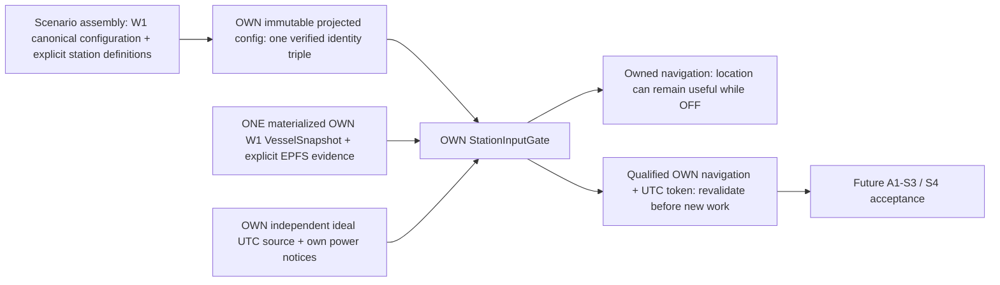

# A1-S2: own station configuration, EPFS and ideal UTC acceptance

Date: 2026-10-21. This is an additive host input boundary for
`LCP-CLASSA-AUTO-TERR-v1`, not an entry FSM, transmitter or RF/UDP simulator.

## Baseline and authority

Starting branch `lab`, HEAD `3b3c55c5a9023fdcdafa4ac79d4727570e37e656`,
`lab: implement A1-S1 Class A AIS payload and communication-state codecs`.
Initial index, worktree and untracked inventory were clean. All 119 tracked
files were SHA256-inventoried before edits; private preset hash and pre-edit
legacy demo/S1 vector bytes retained under ignored `lab/build/a1-s2-research/`.
The existing full configuration exposes 35 CTests. Native baseline: VS2022
MSVC x64, CUDA 12.9.86, sm_61 GTX 1050 Ti, driver 582.78; existing private
`cuda129-pascal` preset read, not edited.

Read authority: all five frozen A0 specification/requirements/test/interface/
review documents; the A1-S1 acceptance report; actual AIS models, encoder and
communication-state interfaces; runtime time representation and implementation;
W1 identities/snapshots, geodesy, canonical configuration validation and host
test patterns. No frozen authority, codec or W1 production semantics are changed.

Normative source is the recorded ITU-R M.1371-6 (02/2026), via the
[official record](https://www.itu.int/rec/R-REC-M.1371-6-202602-I/en).
This slice reuses A0/A0.1/S1's verified current-edition source/table record;
it does **not** claim a fresh external-source verification. Relevant payload
authority: Annex 7 Tables 46/47 (printed 105-107), Table 50 (109-110), Table 51
(111-114), Tables 77/78 (140-142); reporting context Annex 1 Table 1 and
synchronization context Annex 2 Tables 18-20. API ownership, provenance,
versioning, freshness, epoch rules and numerical quantization below are
**SIMULATION_POLICY**, not ITU interface or rounding requirements.

## Public contract and ownership



Only `station_assembly.h` accepts global `world::Config`/a definition vector.
Assembly calls the existing `world::canonical_config`, verifies all identity
references/uniqueness, then returns bounded independent values in stable
VesselId order. It retains no registry and cannot be queried by a station.
Station-facing methods accept one `world::VesselSnapshot`, own evidence and
own clock/power observations; they have no global world/snapshot/vector/peer
lookup argument. Returned data own their values and outlive caller vectors.
The passive receiver is never constructed as a Class A station instance.

`OwnStationConfig` is privately minted after assembly. Explicit inputs include
the exact nonzero W1 VesselId/EquipmentId/RadioId triple, `ais::Mmsi`, Type 5
static/voyage content, complete 24B manufacturer metadata, distinct clock and
EPFS source IDs/provenance, normalized UTC anchor/revision, explicit nonzero
scenario-instance revision and synthetic origin metadata. The scenario
revision is not W1's changing reach/environment revision. Different ideal
sources share the same physical UTC mapping while retaining independent
IDs, epochs, validity and qualification history.

MMSI syntax is delegated to the accepted `ais::Mmsi` API; static/manufacturer
wire validity to unchanged A1-S1 encoders. No name, antenna, ordinal, position
or hash creates an identity or static field. A syntax-valid synthetic MMSI or
IMO/flag number is not an allocation/licensing claim. Explicit codec
unavailable values remain unavailable; missing required source/provenance/
manufacturer or qualified IMO metadata is rejected.

## Versioned policy and exact arithmetic

Opaque source/scenario IDs are 1..64 ASCII characters from `[A-Za-z0-9_.:-]`;
provenance is 1..256 printable ASCII,
with whitespace-only, control or non-ASCII text rejected. The origin scenario
ID must equal the canonical W1 profile ID. `OwnStationConfig` uses copy-
preserving moves so using a moved-from validated value cannot bypass assembly
invariants; mutable definitions are fully revalidated after moves.

| Policy / declaration | Qualified behavior |
|---|---|
| `A1-CLASSA-OWN-STATION-v1`, configuration version 1 | Only frozen profile and exact excluded-function declaration accepted |
| `SYNTHETIC_LAB`, `SYNTAX_ONLY_NOT_ALLOCATION_AUTHORITY` | Explicit bounded provenance; no real assignment or certification assertion |
| `IDEAL_DIRECT_UTC_SIM` | Independent mathematical source, no drift, holdover or invented inter-station phase skew |
| `OWN_W1_TRUTH_AS_EPFS` | Explicit truth-fed pilot fix; not physical GPS, measured precision, PA or RAIM |
| `OWN_POWER_GENERATION_EPOCH-v1` | Own ON establishes a generation, OFF invalidates new qualification, re-ON requires a newer generation |
| Input policy version 1 | Navigation/clock maximum age each explicitly bounded 0..60 seconds; default 0 means exact requested-time sample |
| `OWN-INPUT-QUANTIZATION-v1` | Exact integer nearest, half ties away from zero; no floats, silent narrowing or coordinate saturation |

Position conversion is `round_away(3 * nanodegrees / 5000)` after W1 domain
validation (longitude +/-180 degrees, latitude +/-80 degrees). Intermediate
products fit signed 64-bit after validation. Signs are symmetric; valid points
cannot reach AIS longitude/latitude unavailable markers. Source eligibility
is distinct from quantized output, including sub-unit positions rounding to 0.

Speed conversion rounds milli-knots / 100, then caps at the AIS saturation code
1022. The standalone checked scalar helper handles the full nonnegative int64
domain with quotient/remainder arithmetic; absent speed maps to 1023. Actual
materialized W1 snapshots retain W1's qualified 0..100000 mkn domain. Therefore
speed saturation above 100 knots is a scalar AIS conversion test, not a claim
that W1 produced an out-of-domain trajectory.

COG is optional integer nanodegrees in [0,360 degrees), rounded in 100000000
nanodegree steps. An available course rounding to 3600 wraps to 0; absence
alone maps to 3600. Invalid present course fails closed. W1 status 0,1,3 is
preserved. Heading 511, ROT -128, PA false and RAIM false remain policy
unavailable/defaults: ground course and exact world truth supply none of those
sensor measurements. No dimensions or voyage metadata are synthesized.

UTC decomposition reuses `runtime::decompose_utc`/`compose_utc`, `UtcAnchor`,
`UtcSlot` and their checked 9830400 units/second, 262144 units/slot,
589824000 units/minute, 2250 slots/minute. Negative POSIX minutes use floor
division. Minute, slot and integer phase remain channel-neutral. FIX generation
UTC second is computed from the qualified fix instant, never observation,
encoding, transmit, receive, playback or wall time. AIS second 60 is
unavailable; POSIX leap-second discipline is outside this representation.

## Lifecycle, validity and current-use boundary

The small gate is a lifecycle/input-validity mechanism only. Clock observations
must match own identity/source/category/epoch/anchor/revision and sampling-age
policy. Revocation invalidates prior current-use clock qualifications;
reacquisition establishes a new validity interval. A mere SimulationInstant
cannot mint direct UTC. Fix time before the acquired validity interval is not
qualified as UTC. Unnormalized anchors, future/stale/reversed samples, bad
coordinates/status/speed/course, wrong scenario revision and foreign ownership
fail closed with explicit errors.

Source generation times are monotonic separately for navigation and clock,
even when observation time advances. A new accepted sample supersedes its
prior current-use token. A valid clock refresh preserves acquisition time
only while consecutive source samples stay within the declared clock-age
window; a gap is reacquisition, not retrospective continuous lock. Malformed
foreign/stale observations are rejected as input errors and do not rewrite
known own-source validity; a matching fresh observation with `valid=false`
explicitly revokes it. W1's materialized course-valid flag must agree with
optional COG presence, otherwise the source sample is malformed.

Explicit fix validity is independent of W1 location. No valid fix gives AIS
unavailable position/motion and UTC markers; valid own navigation may continue
while equipment is OFF or UTC is unavailable, but cannot become a qualified
current envelope. `QualifiedOwnInputs` is privately minted with explicit
`SyncState::UtcDirect` qualification. New work must call the gate's revalidation
method, which checks ownership, source/token identity, generation/revisions,
current power/clock and freshness. Tokens are owned historical values; later
OFF/loss does not rewrite the fact they were qualified at their recorded time.

Own authoritative lifecycle notices precede newly emitted work at the same
instant. Actual OFF dominates reactivation/new qualification at that instant;
W1 InitialOff bootstrap is distinguished from an actual OFF. Old-generation
clock/navigation tokens cannot cross re-ON. Revalidation rejects earlier work
if an OFF/revocation arrives at the same instant. No one-tick postponement,
runtime event change, abort contract or journal schema is introduced.

`input_eligible` and valid navigation are separate from `ready_for_tx`.
**S2 always reports transmit readiness false**, including ON+0 and ON+60s.
The future normative passive observation and entry FSM remain mandatory and
are neither implemented nor adjudicated here.

## Operator-input gap and remaining gates

The typed in-memory assembly path is the implemented operator boundary.
**S2-GAP-SIDECAR: NOT IMPLEMENTED**: optional sidecar YAML loading, example
station metadata and complete YAML/operator integration. No synthetic demo
identities were silently added to W1 profiles. There is no new YAML dependency
in the always-available host/AIS/runtime/core assembly targets. Existing W1
YAML schema and goldens remain unchanged.

S1-NOGO-IMO-ZERO and S1-NOGO-UTC-UNAVAILABLE remain unchanged. A0-ISS-003 remains
**UNRESOLVED**; A1-S2 does not decide staggered-channel entry/first-frame or
anchored paths. A0-ISS-004 is outside the ideal direct-UTC profile; clock loss
does not invent a SOTDMA timeout-one no-UTC representation. A1-S3 local maps/
keyed RNG, A1-S4 scheduling, A1-S5 RF observations, RF1, I1, P1 and the five-hour
RF/UDP pilot remain separate NO-GO gates pending their own work.

## Implementation and execution evidence

New production files:

- [station_config.h](../../classa/station_config.h) and
  [.cpp](../../classa/station_config.cpp): definition types and private,
  owned `OwnStationConfig`.
- [station_assembly.h](../../classa/station_assembly.h) and
  [.cpp](../../classa/station_assembly.cpp): global validation/projection only.
- [station_inputs.h](../../classa/station_inputs.h) and
  [.cpp](../../classa/station_inputs.cpp): exact quantizers, `StationInputGate`,
  own power/EPFS/direct-clock observations and private owned qualification
  tokens. No global registry, event producer, payload scheduler or transmitter.
- [classa_station_tests.cpp](../../tests/classa_station_tests.cpp) and
  [classa_station_oracle.py](../../tests/classa_station_oracle.py): new synthetic
  qualification fixtures and independent reference arithmetic.

The only edited existing file is [CMakeLists.txt](../../CMakeLists.txt):
`aismixer_lab_classa_inputs`, `aismixer_lab_classa_assembly`, the new C++ test
target and Python CTest. Both S2 tests carry labels
`host;AIS;classa;station`, C++17 `/utf-8 /W4`, and
`CUDA_VISIBLE_DEVICES=-1`. The existing W1 host target is moved outside the
optional YAML operator block so assembly can reuse its actual validator with
all operators OFF. Its source, dependencies, compiler flags and W1 semantics
remain unchanged; YAML loader and CUDA engine remain optional operator
dependencies, not station input dependencies.

### Independent acceptance already executed

Native MSVC 19.44.35229.0, Python 3.14.7. Fresh separate project
`lab/build/a1-s2-host-only`, configured with `LANGUAGES CXX` only, compiles
the station, assembly, actual W1 host validator, runtime and AIS sources with
no CUDA toolset/language/package and no yaml-cpp. **7/7 CTests PASS**, exit 0,
2.38 s wall time. This includes new station C++/Python tests, unchanged S1
C++/Python, legacy AIS C++/Python and smoke. PE dependency inspection shows
Windows and MSVC/UCRT only, with no CUDA or yaml-cpp import.

Normal main-project configure with **all four optional operators OFF**,
no vcpkg toolchain or yaml-cpp package, successfully builds the new station
test target. Its station-labelled suite: **2/2 PASS**, exit 0, 1.08 s in the
final frozen run. Main
configuration still requires the historical CUDA toolset; it is **not** a
toolkit-free configure. The separate CXX-only project is the independent
host-only reproduction, using the same native compiler, not a cross-compiler.

New C++ tests report **309 assertions, 159 categorized invalid fixtures
rejected**. They include actual canonical W1 triple validation, two-station
projection plus reordering and an unrelated third configured station,
conversion invariance, moved-from metadata/config invariants, compile-time
global-data injection rejection, independent own clocks, fix versus arrival
time, same-instant OFF in both dispatch orders, revocation/reacquisition,
expiration, generation/source/world revision and checked overflow failures.
No synthetic fixture is labelled a production RF observation.

The 159 negative fixtures have 66 detailed test-output categories, grouped
here without double-counting. Full per-category counts are reproducible from
the C++ executable and retained in the independent test log.

| Negative domain | Rejected |
|---|---:|
| Configuration, identity and static metadata | 64 |
| Scalar arithmetic, runtime normalization and overflow | 22 |
| Own navigation/source validation | 31 |
| Clock, lifecycle and current-use qualification | 42 |
| **Total** | **159** |

Independent Python uses standard-library `Fraction` and arbitrary-width
`divmod`, imports no production helper or layout, and checks **99 quantization
rows + 26 UTC rows**, two identical fresh processes, and **5 actual corrupted
row rejections**. Hand examples: +/-2500 ndeg -> +/-2 AIS units;
3750 ndeg -> 2; -180 degrees -> -108000000; +80 degrees -> 48000000;
50 mkn -> 1; 102150 mkn -> 1022; absent speed -> 1023;
359.95 degrees -> 0; absent COG -> 3600. One unit before UTC zero gives
minute -1 / slot 2249 / phase 262143 / second 59. Nonzero anchor phase,
negative POSIX minutes, slot 0/2249/frame wrap, +/-1 unit and 60 s boundaries
are independently checked.

`--vectors` arithmetic output matches across both native compilations:
**3343 bytes**, SHA256
`32bc8b927825b91558012ed75590848764204cd60788848995c6d00a40068179`.
Pre/post historical `--demo`: **583 identical bytes**, SHA256
`bb2838bded8b32ad4d8167109c23c1f4ee837c265c2eddea1f5c4d9f5a8f1314`.
S1 extended `--vectors`: **1783 identical bytes**, SHA256
`5ca21cbd05980375d06f6c150c5dac00015928963aa96062cff44a38f9b94cd2`.
Original codecs, tests, goldens, README, A0 and S1 acceptance records remain
byte-identical. The private preset hash is also unchanged.

The final frozen native Release suite is **37/37 PASS**, exit 0, zero failed
or skipped tests, 138.30 s wall time: labels include 10 GPU, 27 host, 10 AIS,
4 classa and 2 station tests. Final complete CUDA-hidden host suite with
`CUDA_VISIBLE_DEVICES=-1`: **27/27 PASS**, exit 0, zero failed/skipped tests,
**121.27 s** wall time. Both final logs confirm the expanded station test's
309 assertions / 159 negative fixtures. A final log check caught the native
station test being compiled while its last test additions were in flight;
the target was rebuilt after the source freeze (309 assertions / 159 negatives
confirmed) and both complete suites repeated. This is why the final evidence
uses the `*-frozen.log` runs instead of earlier coverage counts.
During development a competing diagnostic build
hit an object-file lock; that competing process was stopped and the sole-owner
native builds completed successfully. No acceptance test or golden was relaxed.

The final native W1 GPU CLI independently passes its unchanged **5319-record**
five-hour trajectory golden, logical FNV-1a64 **`6328099c89f9a685`**, maximum
WGS84 comparison error **0.000064902 m**, with the established GTX 1050 Ti /
CUDA 12.9 / MSVC reference toolchain. Existing block/batch/chunk permutations,
seed replay and no-clobber checks pass. This remains W1 trajectory acceptance,
not five-hour AIS radio or UDP acceptance. R0/R0.1 journals and B3/B3.1 wire/
CLI contracts also pass unchanged in the complete suite.

| Final qualification | Pass / total | Exit | Measured CTest wall time |
|---|---:|---:|---:|
| Fresh native Release, full configured suite | 37/37 | 0 | 138.30 s |
| Separate complete CUDA-hidden host-labelled suite | 27/27 | 0 | 121.27 s |
| Independent CXX-only Release project | 7/7 | 0 | 2.38 s |
| Main project, all optional YAML operators OFF, station label | 2/2 | 0 | 1.08 s |

### Reproduction and retained evidence

Run from repository root in PowerShell. The installed VS2022 CMake location
is resolved from ProgramFiles; the existing private preset supplies the local
toolchain path without embedding a user-specific absolute path in this report.
No preset, dependency or W1 schema is modified by these commands.

```powershell
$taskCmakeBin = Join-Path ${env:ProgramFiles(x86)} 'Microsoft Visual Studio/2022/BuildTools/Common7/IDE/CommonExtensions/Microsoft/CMake/CMake/bin'
$taskCmake = Join-Path $taskCmakeBin 'cmake.exe'
$taskCtest = Join-Path $taskCmakeBin 'ctest.exe'
$taskPreset = (Get-Content lab/CMakeUserPresets.json -Raw | ConvertFrom-Json).configurePresets | Where-Object name -eq 'cuda129-pascal'
$taskToolchain = $taskPreset.cacheVariables.CMAKE_TOOLCHAIN_FILE
$taskCuda = Join-Path $env:ProgramFiles 'NVIDIA GPU Computing Toolkit/CUDA/v12.9'
& $taskCmake -S lab -B lab/build/a1-s2-release -G 'Visual Studio 17 2022' -A x64 -T "cuda=$taskCuda" -DCMAKE_CUDA_ARCHITECTURES=61 -DBUILD_TESTING=ON -DAISMIXER_LAB_BUILD_SCENE_RUNNER=ON -DAISMIXER_LAB_BUILD_GEO_RUNNER=ON -DAISMIXER_LAB_BUILD_RUNTIME_RUNNER=ON -DAISMIXER_LAB_BUILD_WORLD=ON "-DCMAKE_TOOLCHAIN_FILE=$taskToolchain" -DVCPKG_TARGET_TRIPLET=x64-windows
& $taskCmake --build lab/build/a1-s2-release --config Release --parallel 4
& $taskCtest --test-dir lab/build/a1-s2-release -C Release --output-on-failure
$taskOldCudaVisible = $env:CUDA_VISIBLE_DEVICES
try {
    $env:CUDA_VISIBLE_DEVICES = '-1'
    & $taskCtest --test-dir lab/build/a1-s2-release -C Release -L host --output-on-failure
} finally { $env:CUDA_VISIBLE_DEVICES = $taskOldCudaVisible }
python lab/tests/classa_station_oracle.py --exe lab/build/a1-s2-release/Release/aismixer_lab_classa_station_tests.exe
& lab/build/a1-s2-release/Release/aismixer_lab_ais_smoke.exe --demo
& lab/build/a1-s2-release/Release/aismixer_lab_classa_payload_tests.exe --vectors
git diff --check
```

The separate ignored CXX-only reproduction project is
`lab/build/a1-s2-host-source/CMakeLists.txt`. It compiles the new six station
files, the four unchanged AIS implementation files, unchanged `world.cpp` and
the existing nine runtime implementation files. Include directories expose
only classa/ais/world/runtime headers, link the existing host `bcrypt`
dependency, and use C++17 `/utf-8 /W4`. Test executables are the new station
tests, unchanged S1 payload tests, old codec tests and old smoke; register
their C++ tests and the three corresponding Python oracles, seven tests total.
All run with `CUDA_VISIBLE_DEVICES=-1`. No YAML loader, world CUDA session,
`enable_language(CUDA)` or CUDA package/toolchain belongs in that project.

```powershell
& $taskCmake -S lab/build/a1-s2-host-source -B lab/build/a1-s2-host-only -G 'Visual Studio 17 2022' -A x64
& $taskCmake --build lab/build/a1-s2-host-only --config Release --parallel 4
& $taskCtest --test-dir lab/build/a1-s2-host-only -C Release --output-on-failure -V
& $taskCmake -S lab -B lab/build/a1-s2-no-yaml -G 'Visual Studio 17 2022' -A x64 -T "cuda=$taskCuda" -DBUILD_TESTING=ON -DAISMIXER_LAB_BUILD_SCENE_RUNNER=OFF -DAISMIXER_LAB_BUILD_GEO_RUNNER=OFF -DAISMIXER_LAB_BUILD_RUNTIME_RUNNER=OFF -DAISMIXER_LAB_BUILD_WORLD=OFF
& $taskCmake --build lab/build/a1-s2-no-yaml --config Release --target aismixer_lab_classa_station_tests --parallel 4
& $taskCtest --test-dir lab/build/a1-s2-no-yaml -C Release -L station --output-on-failure -V
```

Actual complete configure/build/test outputs, PE dependencies, baseline hashes,
pre/post captures and the arithmetic vector stream remain ignored under
`lab/build/a1-s2-research/`. The full fresh build retains historical sm_61
deprecation and CUB alignment warnings in existing CUDA targets; no new station
source warning is present. Cross-compiler, physical GNSS/UTC hardware, RF/FCS,
UDP, five-hour RF pilot and performance/memory benchmarking are **NOT RUN**,
outside this slice. The historical W1 five-hour trajectory test is distinct
from the unimplemented five-hour RF/UDP pilot.

## Final scope audit and handoff

Ending branch **`lab`**, HEAD unchanged:
**`3b3c55c5a9023fdcdafa4ac79d4727570e37e656`**. Index empty; all changes
unstaged. `git diff --check` passes. All ten delivery files pass strict UTF-8,
no BOM, LF-only, final newline and no trailing whitespace checks.

Exact inventory: one modified tracked file, `lab/CMakeLists.txt`; nine added
files: `lab/classa/station_config.h/.cpp`, `lab/classa/station_assembly.h/.cpp`,
`lab/classa/station_inputs.h/.cpp`, `lab/tests/classa_station_tests.cpp`,
`lab/tests/classa_station_oracle.py` and this
`lab/docs/A1_CLASS_A/A1_S2_STATION_EPFS_UTC_ACCEPTANCE.md`. SHA256 inventory
confirms all **118 other pre-existing tracked files are byte-identical**.
That includes README, A0/A0.1, S1 acceptance/tests/goldens, all AIS codecs,
runtime/journals, world/CUDA production files and existing YAML profiles.
Private preset hash unchanged. No packages installed, no files staged, no
commit/tag/push, and no branch/history/remote operations performed.

**A1-S2 scope: PASS** for the typed in-memory path. Configuration/projection,
own EPFS conversion, independent ideal UTC, lifecycle/current-use qualification
and independent numerical acceptance are implemented. Optional operator YAML
integration remains **S2-GAP-SIDECAR: NOT IMPLEMENTED** and is not represented
as completed operator input.

**Isolated A1-S3 work can begin** using these owned inputs, under a separately
reviewed local-map/keyed-RNG contract and its independent acceptance. This does
not implement or approve a map/RNG algorithm here. A1-S4 still requires the
unresolved **A0-ISS-003** first-frame adjudication; S1-NOGO-IMO-ZERO and
S1-NOGO-UTC-UNAVAILABLE remain in force. A1-S5, RF1, I1 and P1 acceptance and
the genuine five-hour RF/UDP pilot remain **NO-GO**. No first transmission,
RF success, UDP packet, full Class A or IEC conformity is claimed.

Suggested operator-only commit subject (not performed):
`lab: implement A1-S2 station configuration and own EPFS/UTC inputs`.
