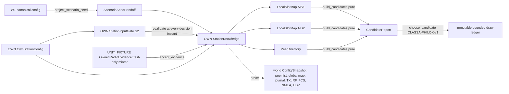

# A1-S3: station-local AIS1/AIS2 slot maps, causal reservation knowledge, restricted candidate engine and semantic Philox acceptance

Date: 2026-10-22. This is an additive host-side knowledge layer for
`LCP-CLASSA-AUTO-TERR-v1`: two owner-local channel maps, an owner-local peer
directory, pure selection-interval/candidate/timeout/RATDMA arithmetic and
the independent `CLASSA-PHILOX-v1` protocol generator. It is not an entry
FSM, a scheduler, a transmitter, an RF/FCS/NMEA/UDP path or a global map.

## Baseline and authority

Starting branch `lab`, HEAD `46601d521ea387765549172b8c307b88654a4fe5`,
`lab: implement A1-S2 station configuration and own EPFS/UTC inputs`. Index,
worktree and untracked inventory were clean at the start; no Git mutation
(checkout/reset/stash/rebase/merge/cherry-pick/tag/stage/commit/push/fetch)
was performed and the index is still empty at the end. Scratch files,
builds and captured logs live only under ignored `lab/build/a1-s3-*`.

Read authority: the five frozen A0/A0.1 Class A documents (specification,
requirements, test matrix, interface/gap register, review/acceptance), the
A1-S1 and A1-S2 acceptance reports, the S1 codec and S2 gate interfaces,
runtime exact time, W1 identities/geodesy/canonical configuration and RNG
keying. No frozen authority, S1 codec, S2 gate or W1 production semantics
are changed; S1/S2 goldens are byte-identical.

Normative source is ITU-R M.1371-6 (02/2026) as recorded by A0/A0.1 via the
[official record](https://www.itu.int/rec/R-REC-M.1371-6-202602-I/en). This
slice reuses the A0/A0.1 verified current-edition source/table readings
(A2-3.1.2/3.1.4/3.1.6, A2-3.2.2.11, A2-3.3.1.2, A2-3.3.4.2/Table 14,
A2-3.3.4.4.2/Table 16/Fig. 11, A2-3.3.5.4, Tables 18-20, A2-4.4.1, Figures
9/15/20/21, Annex 7 Tables 47/49) and the A0 derived readings
A0-MAC-035..040; it does **not** claim a fresh external-source verification,
never substitutes the 2014 edition and claims no official erratum
(A0-MAC-041 and the Table 14 note 2 sign remain recorded source issues).
Everything not quoted from those readings is labelled `SIMULATION_POLICY`.

### Change inventory

| Path | Status | Lines | Role |
| --- | --- | ---: | --- |
| `lab/classa/slot_identity.h` | new | 72 | SLOT-IDENTITY-v1: channel, absolute UTC-frame slot index, checked offsets, 120 NM constant |
| `lab/classa/philox_protocol.h/.cpp` | new | 107/136 | CLASSA-PHILOX-v1: Philox4x32-10, semantic key packing, 24-byte serialization, bounded rejection draw, ledger entry |
| `lab/classa/generic_ratdma_policy.h/.cpp` | new | 118/285 | RATDMA-EXACT-GAP-v1: LCP-P03/P04 generic non-entry bookkeeping with exact big-rational gap |
| `lab/classa/radio_evidence.h` | new | 110 | RADIO-EVIDENCE-v1: UNIT_FIXTURE-only owned observation token, decoded facts, deferred Message 20 |
| `lab/classa/local_directory.h/.cpp` | new | 109/101 | PEER-DIRECTORY-v1: owner-stamped bounded peer directory with slot-exact reach expiry |
| `lab/classa/local_slot_map.h/.cpp` | new | 152/308 | LOCAL-SLOT-MAP-v1: one owner-stamped channel map, retention, physically-newest refresh, aging, horizon |
| `lab/classa/candidate_policy.h/.cpp` | new | 184/439 | CANDIDATE-POLICY-v1: LCP-P01/P02/P05 helpers, slot classes, Rule 1..5 hierarchy, equiprobable choice |
| `lab/classa/scenario_seed.h/.cpp` | new | 37/16 | Scenario seed handoff minted only from the canonical W1 configuration boundary |
| `lab/classa/station_knowledge.h/.cpp` | new | 205/635 | OWN-LOCAL-KNOWLEDGE-v1: gate-bound composition, evidence acceptance, draws, ledger, S3-TIE-ORDER-v1 |
| `lab/tests/classa_knowledge_tests.cpp` | new | 1679 | Synthetic C++ suite (13 sections) and `--vectors` emitter |
| `lab/tests/classa_knowledge_oracle.py` | new | 489 | Independent standard-library oracle (no production import) |
| `lab/CMakeLists.txt` | modified | +27 | `aismixer_lab_classa_knowledge` library, C++ test and Python oracle CTests (labels `host;AIS;classa;knowledge`) |
| `lab/docs/A1_CLASS_A/A1_S3_LOCAL_KNOWLEDGE_PHILOX_ACCEPTANCE.md` | new | this file | Acceptance report |

The unit-fixture compile definition `AISMIXER_LAB_CLASSA_UNIT_FIXTURE` is set
only on the test executable target; the library targets never see it.

## Public contract and ownership



Invariant mapping (brief invariants 1-8):

1. Owner-only state: maps and the directory are stamped with the owner's
   `OwnIdentity` at construction; `build_candidates` refuses mixed owners;
   a `CandidateReport` records its owner, decision slot and knowledge
   revision and is refused by another station. No API takes
   `world::Config`, `world::Snapshot`, a peer vector or a global map.
2. Collisions are not prevented by grants: an own reservation is a local
   expectation. Test `asymmetry_and_isolation` shows two blind stations
   choosing the same slot with no retroactive repair.
3. Peer allocations come only from OWN causal evidence: `accept_evidence`
   checks owner, receiver radio, channel, power generation, catalog
   revision, strictly increasing receipt identity, non-empty nominal
   interval, start at or after the ON epoch, disclosure after physical end,
   monotonic disclosure, disclosure not in the future, disclosure after the
   last decision instant, at most five slots, received slot not in the
   future and not older than the past horizon, all **before** any mutation.
4. Evidence tokens are `UNIT_FIXTURE` only: the minter is declared under the
   fixture macro and defined only in the test translation unit; the class
   definition is identical in every translation unit (unconditional friend).
   Map and directory records carry the provenance label. No production
   factory, Boolean, journal or NMEA text can forge reception.
5. OFF clears maps, directory, reuse exclusions, receipt counter, disclosure
   and decision frontiers and draw watermarks; ON starts a fresh epoch and a
   fresh key domain (power generation is part of every key).
6. S2 inputs are revalidated per decision: `qualified_at() == now` is
   required and the owning `StationInputGate::revalidate` is called inside
   every call, so same-instant revocation, a shadow gate built from a copied
   configuration and an OFF gate are rejected. `ready_for_tx()` stays false.
7. Exact `runtime::SimulationInstant` arithmetic (9 830 400 units/s,
   262 144 units/slot) with checked integer offsets; no float enters any
   decision, only the geodesic distance already qualified by W1 geodesy.
8. No golden or branch change; S1/S2 interfaces untouched; no network, RF,
   FCS, NMEA or UDP code.

## Map and directory model

Each `LocalSlotMap` (one channel, one owner) holds own reservations,
external allocations and garble records keyed by absolute UTC-frame slot
index (`minute * 2250 + slot`, checked, floor-division inverse). Slot states
are `Free`, `InternalOwn`, `ExternalObserved`, `GarbledObserved` (A2-3.1.6).
Policy (LOCAL-SLOT-MAP-v1, `SIMULATION_POLICY`):

- Horizon: 4 past frames (must exceed the 3-frame SOTDMA aging window) and 8
  future frames (covers the 16383-slot ITDMA reach); records entirely below
  the past horizon are pruned on `advance`.
- Own retention: SOTDMA `timeout_frames` is the value advertised at the first
  use, i.e. drawn timeout minus one, domain 0..6; ITDMA keep retains one more
  frame. `retained_frames_from_timeout_draw(T)` maps 3..7 to 2..6, so a drawn
  T covers exactly T frames (asserted against `continuous_timeout_sequence`).
- External retention: `reserved_through_minute` is the last frame in which
  the block's first slot is reserved; SOTDMA bases and ITDMA keep repeat per
  frame, a one-shot ITDMA increment block has `through == first frame` and
  its later slots follow from the block length only (never frame periodic).
- In-place refresh identity: SOTDMA-basis records of one peer at one frame
  slot form one lineage; ITDMA records are identified by (peer, first index,
  basis). Within a lineage the physically newest announcement wins, ordered
  by first index and then by the announcing (decoded) slot index carried on
  every record: older records are replaced, and an older late arrival is
  reported `superseded` and never recorded (so a next-frame offset announced
  in frame F can never overwrite the timeout announced at that slot in frame
  F+1, and an earlier ITDMA announcement never shrinks a later block). The
  refresh scan covers the whole retained span (past + future + 8 frames
  behind, past + future ahead), independent of the horizon shape. A fast
  peer (30 announcements per frame for ten frames) stays within 60 map
  records and 60 directory reservations.
- Aging: a SOTDMA-basis allocation unused for the preceding three frames
  (`now_frame - last_use > 3`) is reported aged (`Free2`), not live; aged
  evidence is kept even when the only live holders are beyond 120 NM.
- Garble (`FailedFcs`/`EnergyOnly`) carries no identity and is treated as
  free by a Class A station (A2-3.1.6).
- Capacities: own 64, external 9000, garble 4500 per map (configurable
  within 1..65536); own blocks 1..5 slots; checked arithmetic everywhere,
  including far-future/near-minimum indices and negative POSIX anchors.
- Canonical ordering: live/aged records in a `SlotView` and
  `external_allocations()` are ordered by (first index, MMSI, basis);
  `SlotView` pointers are valid only until the next non-const call.

The `PeerDirectory` (PEER-DIRECTORY-v1) is keyed by validated remote MMSI
(capacity 1024, at most 128 cached announcements per peer, same lineage and
recency rule as the map) and expires a peer last heard before the past
horizon unless one of its announcements still covers the current slot or a
later one (slot-exact, so a one-shot block straddling a frame boundary keeps
its peer until its last slot has passed). Identity facts (position, sync
state, last channel/slot) follow the physically latest decode; a late
disclosure of an older frame never regresses them, and a message that does
not carry a field (Message 20 position/state, an undecodable communication
state) never erases what an earlier decode established.

## Evidence boundary and unresolved outcomes

`OwnRadioObservation` carries owner, receiver radio, channel, power
generation, catalog revision, receipt identity, nominal physical interval,
disclosure instant, disposition (`Decoded`/`FailedFcs`/`EnergyOnly`),
optional decoded facts and provenance. RADIO-EVIDENCE-v1 states that the
interval is the nominal slot-aligned span, not an RF envelope; the 1 ms tail
and timing error are a future RF1/S5 seam policy.

Decoded Messages 1/2/4 apply Table 18 (`SotdmaTimeout` through
`frame + timeout`, `ObservedUse` for timeout 0, `SotdmaNextFrameOffset` for a
positive offset landing in the next frame); Message 3 applies Tables 19/20
(`ItdmaKeep`, one-shot `ItdmaIncrement` block of 1..5 slots). The decoded
frame's own slot use is always learned. Implausible announcements no longer
discard an FCS-valid decode: they are returned as typed `unresolved`
entries with no allocation (`sotdma_offset_not_next_frame`,
`slot_number_submessage_disagrees_with_own_utc` (retention still applies),
`itdma_block_beyond_local_horizon`, `sotdma_offset_beyond_local_horizon`,
`communication_state_undecodable:<codec reason>`). Message 20 is accepted
only as `decoded_base_message_deferred` (slot use and base identity, no link
management reservation; A0-MAC-022 pairing stays outside the profile).
Announcements older than a known lineage record are returned as
`superseded`; every recorded allocation carries its announcing slot.
Ownership, epoch, causality, identity and malformed-field violations remain
exceptions thrown before any mutation.

## Policy mappings and test identities

Test identities: `KT.<section>` is a section of
`lab/tests/classa_knowledge_tests.cpp`; `OR.<FAMILY>` is a vector family
recomputed by `lab/tests/classa_knowledge_oracle.py`; A0 matrix identities
are the frozen oracles they serve.

| Policy | Rule as implemented | Tests |
| --- | --- | --- |
| LCP-P01 (A0-MAC-039) | NI must reduce exactly to 75/125/225/375; inclusive `[NS - floor(NI/10), NS + floor(NI/10)]`, widths 15/25/45/75; NS 1000/NI 375 includes 1037 and excludes 1038; 75/2 and 750/20 rejected, never rounded; signed wrap across frames | `KT.selection_and_adjacency`, `OR.SI`, `OR.SIREJECT`; A0-T05/T08 |
| LCP-P02 (A0-MAC-037) | one decrement before the zero test: 3 advertises 2,1,0 and 7 advertises 6..0; zero announces the next-frame offset `2250 + new - old` for the old slot; own retention equals drawn timeout minus one | `KT.timeout_and_expiry`, `KT.map_contract`, `OR.TIMEOUT`, `OR.EXPIRY`; A0-T06/T08 |
| LCP-P03 (A0-MAC-036) | replenish only when `C + A < 4`, ascending distinct eligible slots in `(current, original RTES]`, never previously attempted or removed; RTES immutable; explicit `pending`/`exhausted`/`deadline_passed` | `KT.ratdma_contract`; A0-T09 |
| LCP-P04 (A0-MAC-019..021) | exact rationals, `u` in 0..100 inclusive, request iff `u <= p`, `delta = (100 - p)/C` from pre-update values; C4/p25: u25 passes, u26 gives 175/4,C3,A1, u43 passes, u44 gives 125/2; C5/p20: 21 gives 36 then 52; C150: delta 149/225, p 299/225; 26/101 acceptance; 40 interleaved removals/inhibitions give exactly 6264842590398423236034723643154476/194129042518445670321426145332675 | `KT.ratdma_contract`, `OR.RATDMA` (154 rows, widest term 37 digits); A0-T09/T16 |
| LCP-P05 (A0-MAC-040) | exactly j-1, j, j+1 in absolute indices for every own slot on the other channel in every retained frame (j=0 reaches the previous frame's 2249, j=2249 the next frame's 0); j+/-2 untouched; `reserve_own` refuses opposite/adjacent own occupancy | `KT.selection_and_adjacency`, `KT.candidate_hierarchy`, `OR.ADJ`, `OR.CAND` (`adjacency_and_base`); A0-T05/T08 |
| LCP-P08 (A0-SIM-016) | CLASSA-PHILOX-v1 keyed by scenario seed, own equipment, power generation, purpose, episode, draw index and rejection index; bounded rejection sampling; immutable ledger; strictly increasing (episode, draw) per purpose and generation | `KT.philox_contract`, `KT.knowledge_draws_and_lifecycle`, `OR.PHILOX`, `OR.PACK`, `OR.DRAW`, `OR.CHOICE`; A0-T15/T16 |

Candidate hierarchy (A2-3.3.1.2, A2-4.4.1, Figures 9/20/21; ordering and
pools are `SIMULATION_POLICY`): classes `Free1`, `Free2` (aged SOTDMA),
`Available1` (held by the most distant eligible mobile over the pool of
slots that could still be chosen, on either map), `Available2`,
`Unavailable` (base within 120 NM, positionless or expired peer, own
position unavailable, peer under a one-frame reuse exclusion, indeterminate
range), `OwnAllocated`, `OwnAdjacentExcluded`. Tier 0 (free/free) admits
every block; tiers 1..5 (Rules 1..5) admit in order until four candidates
exist; in-tier order is (Free1/Available1 before Free2/Available2 on the
selection channel then the other channel, larger selection-channel reuse
distance first, then larger other-channel reuse distance, lower index
first). Exactly 120 NM is within range. Future-only: a block containing
the decision slot or an earlier slot is never a candidate; frame-contained:
a multi-slot block never crosses the frame boundary (A0-MAC-013 expected
evidence, also enforced for own reservations); the Figure 9 current-slot
fallback is reported explicitly (`current_slot_usable`/`no_reservation`).
A block reusing several stations names them all and choosing it excludes
every one of them for one frame. `KT.candidate_hierarchy`,
`KT.review_regressions` and `OR.CAND` (12 named scenes, including a
decision slot inside the interval and a two-slot block over two stations)
cover each rule; equal-distance ties go to the lowest MMSI.

## CLASSA-PHILOX-v1

Portable Philox4x32-10: multipliers `0xD2511F53`/`0xCD9E8D57`, Weyl
increments `0x9E3779B9`/`0xBB67AE85`, ten rounds, reproducing the three
Random123 known answers (zero, all-ones, pi digits). Key =
(seed low 32, seed high 32); counter[0] = equipment id (nonzero),
counter[1] = episode (32 bits), counter[2] = generation[23:0] | purpose << 24,
counter[3] = draw[15:0] | rejection << 16 | version 1 << 24. Purposes 101
`EntryNominalStartSlot` (draw only; the entry interval stays with S4 under
A0-ISS-003), 102 `CandidateChoice`, 103 `ContinuousTimeout` (3..7), 104
`GenericRatdmaProbability` (0..100), 105 `IntentionalReusePeer` (reserved
for S4: equiprobable among peers tying at the maximum reuse distance; S3's
own hierarchy breaks ties by index and never consumes it). The 24-byte
serialization is the six packed words little-endian in order key0, key1,
counter0..3. Bounded draw over `n = max - min + 1 <= 2^32`: word 0 of the
block for rejection index r = 0, 1, ... (at most 64) is accepted iff
`word < floor(2^32 / n) * n`, value `min + word % n`; every proposal is kept
in the ledger entry with span, limit, rejections, accepted word, value,
input digest (FNV-1a64 of the canonical candidate text) and outcome. W1's
counter[2] is `draw / 4 < 2^30`, every protocol counter[2] is at least
`0x65000001`, so the tuple sets are disjoint even for entity 0.

## StationKnowledge composition

`StationKnowledge(config, gate, seed, limits)` binds one owner, one S2
gate (same identity and scenario revision) and one seed handoff. Every call
takes OWN `QualifiedOwnInputs` and the decision instant; `synchronize`
revalidates through the gate, adopts the owner's UTC slot (monotonic),
advances both maps, expires the directory and reuse exclusions and bumps
the knowledge revision when the slot changes. S3-TIE-ORDER-v1
(`SIMULATION_POLICY`): reception precedes decision at an equal instant
(evidence disclosed at or before the last decision instant is rejected as
late); OFF dominates ON and new work at its instant; retention is inclusive
of the last frame while reuse exclusions end exclusively; a report is
consumable only at its own decision slot, knowledge revision and own-input
fingerprint (fix instants, position, clock sample); a release that finds
nothing is not a decision; draw keys strictly increase per purpose within a
generation; the ledger (default 16384
entries) rejects further draws explicitly when full until `drain_ledger()`
exports them (issued/drained counters keep the history auditable, nothing is
dropped silently).

## Golden vectors

`aismixer_lab_classa_knowledge_tests --vectors` emits header
`A1-S3|SYNTHETIC_KNOWLEDGE_FIXTURE|1` and 461 rows in 15 families (PHILOX 5,
PACK 60, DRAW 160, SI 9, SIREJECT 5, ADJ 6, RATDMA 154, TIMEOUT 5, EXPIRY 4,
RANGE 6, POS 7, ABS 11, ABSOFF 8, CAND 12, CHOICE 9): 44 886 bytes,
SHA256 `28faaace53aa323bd83667e6af02200557f4b8c6c0db554f5221b2ed7530524d`,
byte-identical from the CXX-only wrapper build and from the main Release
build (see validation stage F). The oracle recomputes every row from the
written definitions (its own Philox, packing, rejection draw, `Fraction`
RATDMA, P01/P02/P05 sets, expiry, range, position, absolute arithmetic and
the candidate hierarchy including the most-distant pool, the own-adjacency
placement, future-only and frame-contained blocks), rejects 14
corrupted-row variants and requires two byte-identical fresh processes.

## Scoped APIs, boundaries and fixtures

Delivered for S4: `LocalSlotMap`, `PeerDirectory`, `selection_interval`,
`own_adjacency_exclusions`, `build_candidates`/`choose_candidate`,
`continuous_timeout_visit/sequence`, `retained_frames_from_timeout_draw`,
`expiry_announcement`, `range_class`, `ais_position_to_nanodegrees`,
`start_generic_ratdma`/`ratdma_attempt`/`remove_peer_candidate`/
`replenish_candidates`/`ratdma_status`, `philox4x32_10`/`pack_draw`/
`serialize_draw_position`/`bounded_draw`, `project_scenario_seed`,
`StationKnowledge` (`apply_power`, `synchronize`, `accept_evidence`,
`reserve_own`, `release_own`, `candidates`, `choose_candidate`,
`draw_timeout`, `draw_ratdma_probability`, `draw_entry_offset`,
`choose_reuse_peer`, `drain_ledger`, `snapshot`).

Not delivered (future slices): the entry/first-frame decision and NSS
interpretation (S4, A0-ISS-003), the scheduler and transmitter (S4/S5), the
production evidence minter, RF reception, FCS, RF1 envelope tolerance,
I1/P1/NMEA/UDP, Message 20 link management, base operation, assigned mode
and fractional NI (37.5). `EvidenceProvenance` has one value; a production
value is a versioned S5 change, not an S3 flag.

TEST FIXTURES (never evidence of reception, TX or RF): the synthetic W1
world `SYNTHETIC-A1-S3-WORLD-v1` (revision 17, effective seed 42), three
synthetic stations (vessel/equipment/radio 11/21/31, 12/22/32, 13/23/33;
MMSI 000000001..3), the ideal direct UTC source with anchor {0,0}, own W1
truth as EPFS, every `OwnedRadioEvidence` minted by the test-only
`UnitFixtureEvidenceAccess::mint` (provenance forced to `UNIT_FIXTURE`),
peer positions from `geodesic_direct`, and all hand-written expected values.

## Independent review triage

A multi-agent review of the first delivery produced 46 findings. Five were
stale (placeholder test and CMake wiring that the real delivery had already
replaced) and one was informational (verified-correct derivations). The
rest were triaged against the code and resolved in this delivery:

| Theme | Resolution |
| --- | --- |
| int64 overflow of the exact RATDMA recurrence under interleaved removals (F9/F35), unchecked RTES subtraction (F38), INT64_MIN negation (F45) | RATDMA-EXACT-GAP-v1 big-rational gap representation; checked RTES bound; `ExactRational` strings; 40-step interleaved literal and 150-step exhaustion tests; oracle requires terms wider than 64 bits |
| per-peer accumulation of SOTDMA records and 64-entry bound (F10) | in-place refresh per (peer, frame slot); bound 128; ten-frame fast-peer test |
| ITDMA block straddling a frame boundary reappearing next frame (F6/F11/F36) | one-shot blocks have `through == first frame`; map and knowledge tests at slot 2248 |
| directory mutated before map rejection below the past horizon (F1/F37) | explicit pre-mutation horizon check; maps recorded before the directory; untouched-state test |
| no gate revalidation / shadow gate (F2) | gate reference in the constructor and `revalidate` inside every call; revoked and shadow-token tests |
| no decision watermark (F19), unnamed tie policies (F26) | S3-TIE-ORDER-v1 with `last_decision_at` frontier; late-evidence tests; tests reordered to deliver evidence before decisions |
| stale report consumption and owner mixing (F5/F8/F25) | owner, decision slot and knowledge revision stamped in the report and verified on choice |
| whole-report rejection of FCS-valid decodes (F14/F21), Message 20 (F34) | typed `unresolved` entries with observed use retained; `decoded_base_message_deferred` |
| provenance labels and ODR-divergent class (F3/F20/F44) | provenance on map/garble records and snapshot rows; unconditional friend; minter defined only in the test unit |
| own retention vs P02 (F12/F27) | `timeout_frames` = drawn minus one, domain 0..6, helper and frame-count test |
| directory expiry shorter than ITDMA reach (F13), older-receipt regression (F7), tie/ordering determinism (F31), current slot as candidate (F32) | reach-aware `expire_stale`; monotonic identity merge; canonical ordering and lowest-MMSI tie; future-only candidates |
| caller-chosen keys (F23), silent ledger eviction (F24), entry bound (F28), unused purpose 105 (F29), unlabelled constants (F30), W1 separation wording (F33), interval semantics (F22), SlotView lifetime (F43) | per-purpose watermarks; explicit full-ledger rejection with drain; purpose-neutral bounds; documented rule; versioned policy identifiers and the `past_frames > 3` constructor check; corrected comment plus disjointness test; RADIO-EVIDENCE-v1 nominal-span contract; lifetime rule |
| overflow in retention/aging/view/snapshot arithmetic (F39/F40/F41/F42) | checked bounds in `record_external`, overflow-safe distance helpers, saturating view key, overflow-safe snapshot width, selection interval bounded to the map horizon; extreme-index tests |

A second adversarial workflow over the fixed sources (five dimension
finders, three refuters per finding) ran out of session quota after four
finders and three refuters had completed: 17 further findings arrived
unverified except the first (refuted 3/3: the `Exhausted`/`DeadlinePassed`
vocabulary is consistent with the A0-SIM-011 atom; the header now states
the LCP-P03 reading explicitly). All others were reproduced by hand and
resolved here:

| Theme | Resolution |
| --- | --- |
| equal-first-index lineage tie, ITDMA announcements replaced unconditionally, refresh scan window tied to a constant instead of the horizon | announcing slot index on every record; physically-newest rule by (first index, announcing slot) for SOTDMA lineages and by announcing slot for ITDMA; scan over the whole retained span; map and knowledge tests for late offsets, older ITDMA blocks and a short future horizon |
| directory reach frame-granular for straddling one-shot blocks | slot-exact `expire_stale(oldest_heard_index, now_index)` with `reservation_last_index`; directory reservations pruned by last covered slot |
| aged evidence lost behind a beyond-range holder | `Free2` when no holder is within 120 NM and aged evidence exists |
| most-distant pool over unusable slots, other-channel distance ignored in Rule 1/3 order, one reuse peer per multi-slot block | pool restricted to choosable slots; other-channel distance as the secondary key; `reuse_peers` on every candidate, all excluded on choice; emitter and oracle rules updated (`+`-joined peers, A1 marks exactly the pool maximum) |
| decision-slot and fallback columns were emitter literals; future-only path never in a vector | `report.now_index` emitted; new `now_inside_si_most_distant` and `two_slot_two_peers` scenes in vectors and unit tests |
| oracle took Available1 and own-adjacency placement as given | oracle derives A1 from the eligible pool and checks X against O neighbours |
| blocks crossing the frame boundary (A0-MAC-013 traceability evidence) | frame-contained candidate blocks and own reservations, mirrored in the oracle |
| Message 20 / undecodable state erased position and synchronization facts | fields not carried by the message are never overwritten |
| report freshness blind to superseded own inputs | own-input fingerprint stamped on the report and verified on choice |
| no-op release advanced the decision watermark | watermark only on an actual release |
| snapshot loop at INT64_MAX, replenishment before the creation slot | loop terminates before incrementing; `current_index >= creation_index` required |

## Validation stages executed

All logs are under ignored `lab/build/a1-s3-research/`. Tool chain: VS2022
BuildTools MSVC 19.44 x64, CMake/CTest 3.31.6, CUDA 12.9 (hidden for host
runs), Python 3.14.7, `/utf-8 /W4` on every new target with zero warnings.

### Stage A: static checks

19 new/changed files checked: UTF-8, LF, no BOM, no trailing whitespace,
final newline, `git diff --check` clean. Change inventory above.

### Stage B: focused native host tests and oracle (CXX-only wrapper)

```
cmake --build lab/build/a1-s3-host-only --config Release           # build-host-only-4-all.log, 0 warnings
CUDA_VISIBLE_DEVICES=-1 lab/build/a1-s3-host-only/Release/knowledge_host_tests.exe   # knowledge-tests-run-4.log
python lab/tests/classa_knowledge_oracle.py --exe <knowledge_host_tests.exe>          # oracle-run-4.log
```

Result lines:

```
A1-S3 synthetic local-knowledge tests PASS: 847 assertions, 157 categorized invalid fixtures rejected; no transmission, RF reception, FCS, NMEA or UDP produced
A1-S3 independent oracle PASS: 461 rows, 15 families, 14 corrupted rows rejected, 2 fresh processes; 44886 bytes SHA256=28faaace53aa323bd83667e6af02200557f4b8c6c0db554f5221b2ed7530524d
```

Negative categories (46, 157 rejections): LCP-P01 domain 5; LCP-P02 domain
7; LCP-P05 domain 2; OFF decision 2; RATDMA domain 12; RATDMA exhausted 1;
RNG key domain 8; RNG key replay 4; RNG range 3; choice domain 1; directory
capacity 1; directory domain 4; entry domain 2; evidence catalog 1; evidence
channel 1; evidence epoch 4; evidence horizon 1; evidence identity 3;
evidence late 3; evidence malformed 8; evidence owner 3; evidence replay 2;
evidence time 7; external domain 12; foreign inputs 3; garble domain 2;
invalid fix 1; knowledge limits 1; ledger full 1; lifecycle 7; map capacity
3; map instant 2; map limits 3; own domain 8; own overlap 1; own transmitter
2; position domain 2; rational 1; reuse domain 2; revoked inputs 1; seed
handoff 4; slot identity 4; slot identity overflow 3; snapshot domain 2;
stale inputs 4; stale report 3.

### Stage E (run before D): separate CXX-only, no-CUDA, no-yaml project build

`lab/build/a1-s3-host-source/CMakeLists.txt` (ignored) compiles runtime,
world, codec, S2 and S3 sources without CUDA or yaml and registers nine
tests. `ctest --test-dir lab/build/a1-s3-host-only -C Release` with
`CUDA_VISIBLE_DEVICES=-1`: 9/9 passed in 1.57 s (`ctest-host-only-4.log`),
including the historical S1/S2/legacy C++ and Python oracle tests.

### Stages C/D/F: main configured native Release build and CTest

Commands (`main-release-pipeline.sh`, cumulative wall 278 s):

```
cmake -S lab -B lab/build/a1-s3-release -G "Visual Studio 17 2022" -A x64 -T cuda=12.9 -DCMAKE_CUDA_ARCHITECTURES=61 -DBUILD_TESTING=ON \
      -DAISMIXER_LAB_BUILD_SCENE_RUNNER=ON -DAISMIXER_LAB_BUILD_GEO_RUNNER=ON -DAISMIXER_LAB_BUILD_RUNTIME_RUNNER=ON -DAISMIXER_LAB_BUILD_WORLD=ON \
      -DCMAKE_TOOLCHAIN_FILE=<vcpkg toolchain from the private preset> -DVCPKG_TARGET_TRIPLET=x64-windows      # main-configure.log, 17 s (incremental)
cmake --build lab/build/a1-s3-release --config Release --parallel 4                                              # main-build.log, 36 s cumulative, 0 compiler warnings
ctest --test-dir lab/build/a1-s3-release -C Release --output-on-failure                                         # main-ctest-full.log (stage D)
CUDA_VISIBLE_DEVICES=-1 ctest --test-dir lab/build/a1-s3-release -C Release -L host --output-on-failure         # main-ctest-host.log (stage C)
cmake -S lab -B lab/build/a1-s3-no-yaml ... -DAISMIXER_LAB_BUILD_SCENE_RUNNER=OFF -DAISMIXER_LAB_BUILD_GEO_RUNNER=OFF \
      -DAISMIXER_LAB_BUILD_RUNTIME_RUNNER=OFF -DAISMIXER_LAB_BUILD_WORLD=OFF; cmake --build ... --target aismixer_lab_classa_knowledge_tests
ctest --test-dir lab/build/a1-s3-no-yaml -C Release -L knowledge --output-on-failure                            # noyaml-ctest.log (stage E, no yaml/world runner)
```

| Stage | Tests | Result | Wall |
| --- | ---: | --- | ---: |
| D: full configured native Release CTest (CUDA visible, includes CUDA geo/runtime tests) | 39 | 100% passed, 0 failed | 122.29 s |
| C: host-labelled CTest with `CUDA_VISIBLE_DEVICES=-1` (historical S1/S2/legacy/runtime/world host tests included) | 29 | 100% passed, 0 failed | 97.62 s |
| E: no-yaml/no-world-runner project build, knowledge-labelled CTest (C++ + Python oracle) | 2 | 100% passed, 0 failed | 0.46 s |

Stage F (repeated clean-process determinism and historical goldens):

```
A1-S3 synthetic local-knowledge tests PASS: 847 assertions, 157 categorized invalid fixtures rejected; no transmission, RF reception, FCS, NMEA or UDP produced
A1-S3 independent oracle PASS: 461 rows, 15 families, 14 corrupted rows rejected, 2 fresh processes; 44886 bytes SHA256=28faaace53aa323bd83667e6af02200557f4b8c6c0db554f5221b2ed7530524d
main Release vectors    SHA256=28faaace53aa323bd83667e6af02200557f4b8c6c0db554f5221b2ed7530524d (44 886 bytes; identical to the CXX-only wrapper build)
legacy demo (unchanged) SHA256=bb2838bded8b32ad4d8167109c23c1f4ee837c265c2eddea1f5c4d9f5a8f1314 bytes 583
S1 vectors (unchanged)  SHA256=5ca21cbd05980375d06f6c150c5dac00015928963aa96062cff44a38f9b94cd2 bytes 1783
S2 vectors (unchanged)  SHA256=32bc8b927825b91558012ed75590848764204cd60788848995c6d00a40068179 bytes 3343
```

The oracle ran the main Release executable twice in fresh processes
(`oracle-run-main.log`) and once more against the wrapper executable
(`oracle-run-4.log`); all four processes produced the same bytes. Negative
provenance cases (foreign owner/receiver, stale/foreign power epoch, wrong
catalog revision, replayed receipt, revoked and shadow-gate inputs, late and
pre-horizon evidence) are part of every run above.

## Open gates (unchanged by this slice)

- A0-ISS-003 UNRESOLVED: network entry, first-frame phase and NSS
  interpretation; S3 only supplies the `EntryNominalStartSlot` draw and the
  pure candidate engine; no S4 solution is claimed.
- A0-MAC-041 unresolved printed Table 14 defects; A0-ISS-004 no-UTC timeout 1
  excluded by valid ideal direct UTC, not solved.
- S1-NOGO-IMO-ZERO and S1-NOGO-UTC-UNAVAILABLE remain in force; S2-GAP-SIDECAR
  remains open.
- RF1 (physical tail, timing error, envelope tolerance), FCS, datum, I1 and
  P1 gates remain open; the production evidence minter (S5) does not exist.
- Deferred by design: Message 20/base link management, assigned mode and
  fractional NI, ITDMA entry keep/offset interpretation beyond Table 20.

## Decisions

- D1-S3: **GO** for the A1-S3 scope as delivered here (host-side owner-local
  maps, directory, pure restricted candidate/SI/timeout/RATDMA arithmetic and
  CLASSA-PHILOX-v1), conditional on S4 adopting S3-TIE-ORDER-v1 (deliver
  evidence before decisions at an equal instant, drain the ledger, strictly
  increasing draw keys) and on the gates above staying open.
- D2 five-hour RF/UDP pilot: **NO-GO** (unchanged): no RF reception, FCS,
  entry FSM, transmitter, NMEA or UDP path exists; every observation in this
  slice is a `UNIT_FIXTURE`.

## Ending Git status

Branch `lab`, HEAD `46601d521ea387765549172b8c307b88654a4fe5` (unchanged), index empty, nothing staged or
committed. `git status --short --untracked-files=all`:

```
 M lab/CMakeLists.txt
?? lab/classa/candidate_policy.cpp
?? lab/classa/candidate_policy.h
?? lab/classa/generic_ratdma_policy.cpp
?? lab/classa/generic_ratdma_policy.h
?? lab/classa/local_directory.cpp
?? lab/classa/local_directory.h
?? lab/classa/local_slot_map.cpp
?? lab/classa/local_slot_map.h
?? lab/classa/philox_protocol.cpp
?? lab/classa/philox_protocol.h
?? lab/classa/radio_evidence.h
?? lab/classa/scenario_seed.cpp
?? lab/classa/scenario_seed.h
?? lab/classa/slot_identity.h
?? lab/classa/station_knowledge.cpp
?? lab/classa/station_knowledge.h
?? lab/docs/A1_CLASS_A/A1_S3_LOCAL_KNOWLEDGE_PHILOX_ACCEPTANCE.md
?? lab/tests/classa_knowledge_oracle.py
?? lab/tests/classa_knowledge_tests.cpp
```

Suggested commit subject (not executed):
`lab: implement A1-S3 station-local AIS maps and semantic Philox`.
