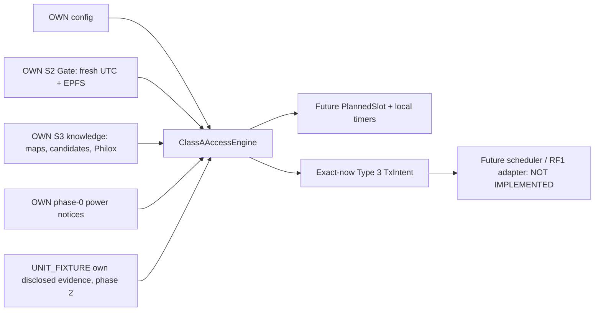

# A1-S4-A: autonomous entry and first-frame local intents

Validation date: 2026-10-26 (implementation brief dated 2026-10-25).
Scope: one owner's host-side access engine, not full S4,
physical RF, runtime event integration, NMEA/UDP or ITU/IEC conformity.

## Baseline, authority and fixture-coordinate correction

Starting branch `lab`, HEAD `76aa1ac5c32205f639a0c676595f844910e301d7`,
`lab: make A1-S3 evidence acceptance atomic before S4`. Index/worktree/
untracked inventory clean. All 151 tracked files SHA256-inventoried before
editing; private preset hash and legacy/S1/S2/S3 binary stdout captured under
ignored `lab/build/a1-s4-a-research/`. The prior full configuration exposes
39 CTests. Native baseline: VS2022 MSVC x64, CUDA 12.9.86, sm_61 GTX 1050 Ti,
driver 582.78. No branch switch, network operation or dependency installation.

Read authority: all five A0/A0.1/A0.2 files, all three frozen S4.0 documents,
accepted S1/S2/S3 and S3.1 reports, and actual station/gate/knowledge/maps/
directory/candidate/seed/Philox/evidence, codec, time/event/scheduler and
historical test interfaces. S4.0 causal-contract Section 4 describes the OLD
S3 defect; the accepted S3.1 staged transaction is authoritative and unchanged.
Normative edition remains ITU-R M.1371-6 (02/2026) as verified in those
records. No fresh original-source verification or PDF rasterization is claimed.

**Brief fixture erratum, not a first-frame-policy change:** the brief's F1
restatement combines anchor `{0,0}` with indices/instants copied from frozen
adjudication Section 6. The latter explicitly uses POSIX anchor
`{1900000000,0}`, minute origin M0 = 31666666, and display index
`(UTC minute - M0)*2250 + slot`. These display indices are not S3's true
absolute UTC indices. The true index is display index + **71249998500**;
the listed simulation instant is `(display index - 1500)*262144`.

Minimal independently checked witness: at anchor zero, ON 7 s is slot 262
plus phase 131072, not 1762; ON+60 = 67 s is absolute slot 2512 plus phase
131072, not 4012; first-A instant 697827328 is slot 2662, not 4162.
An anchor with a 40 s minute phase reconciles all original numbers. This
implementation preserves the authoritative frozen fixture and reports both
display and true absolute indices. Separate zero-anchor tests use the correct
arithmetic. No frozen document, policy, runtime clock or codec is changed to
force inconsistent numbers to agree. A0-SIM-017's chain mechanism is unaffected.

## Boundary and policy markings



The engine has no global world/config/snapshot, peer lookup, scheduler pending
queue, wall clock or network API. One config and its gate/knowledge references
must outlive the engine. Constructor checks station/scenario/configuration
equivalence; the existing knowledge's private Gate reference cannot be
introspected without changing S3. Mandatory S2 plus S3 revalidation on the
first and every subsequent step proves actual token lineage before any draw
or reservation. Static constructor checks are not falsely called private-
pointer identity checks; shadow-gate tokens fail before protocol decisions.

| Rule | Classification / authority |
|---|---|
| Elapsed 60 s observation, first Message 3, carrying-channel ITDMA, entry exempt from generic p-persistence, first-frame keep | `NORMATIVE_EXPLICIT`, A0-MAC-011/018/025/026/033 |
| First-NTS anchor and one-frame 2250-slot duration | `NORMATIVE_DERIVED` with frozen counterexamples, S4.0 FF-05/06/09 |
| Inclusive NSS domain, separate per-channel terminal zeros, cancellation/intents seam | `SIMULATION_POLICY`, A0-SIM-017 `CLASSA-FIRST-FRAME-v1` |
| Integer SI | Frozen LCP-P01: NI 375/225/125/75, widths 75/45/25/15 |
| Timeout drawn 3..7, retained as drawn-1 | Frozen LCP-P02 and actual S3 own-reservation contract |
| Opposite-channel +/-1 exclusion | Frozen LCP-P05 and actual S3 reservation checks |
| Protocol random choices | Frozen LCP-P08 `CLASSA-PHILOX-v1`, purposes 101/102/103 only |
| Bounded retry | New `SIMULATION_POLICY` `CLASSA-ENTRY-RETRY-v1`, default 16 attempts, configurable 1..256 |
| Histories/input-failure handling/fixed-rate fixture mode | S4-A API `SIMULATION_POLICY`, not ITU protocol definitions |
| Per-channel interpretation as source truth | Still `UNSPECIFIED_OR_CONFLICT`, A0-ISS-003 |
| Rr < 2 including anchor/moored 1/3 | NO-GO, A0-ISS-007; typed `blocked_low_rate_policy_absent` |

No LCP-P01..P08 change, invented LCP-P09, global allocator or production
evidence minter. S1-NOGO-IMO-ZERO, S1-NOGO-UTC-UNAVAILABLE, A0-ISS-004 and
A0-MAC-041 remain open. S2/S3 `ready_for_tx()` remain permanently false.

## API, rates and state transitions

New `access_engine.h/.cpp`: `kAccessEngineVersion=1`,
`CLASSA-ACCESS-ENGINE-v1`, `AccessPolicy`, `ClassAAccessEngine`, `AccessState`,
`ChannelPhase`, `ChannelPlan`, `PlannedSlot`, `TxIntent`, `EngineStep`,
`TimerChange`, `EngineSnapshot` and typed `BlockedReason`.

`EngineStep.proposals` contains future `PlannedSlot` values; no future own
instrument reading or completed communication state is fabricated there.
`EngineStep.intents` contains only fully formed **DUE-at-now** Type 3 intents,
once per exact slot start with fresh exact-now S2 input. They include owner,
epoch, channel, absolute slot/start, one-slot length, entry/first-frame/
terminal flavor, semantic ITDMA raw19, S2 fields/provenance/fingerprint, S1
encoded AIS data payload, decision/knowledge revision and draw-ledger IDs.
Armoring metadata from `ais::encode` is not an NMEA record or physical frame.
No intent is named sent, decoded or physically completed.

| Supported Rr/min | NI | Same-channel G | Per-channel nonterminal + terminal |
|---:|---:|---:|---:|
| 6 | 375 | 750 | 3 + 1 |
| 10 | 225 | 450 | 5 + 1 |
| 18 | 125 | 250 | 9 + 1 |
| 30 | 75 | 150 | 15 + 1 |

`OwnSteadyNavigation` uses only qualified own SOG/status for a bounded steady
Table 1 subset (6/10/30), retaining LCP-P06's 14-knot boundary; anchor status
at <=3 knots is blocked low rate. No course-change history is inferred from
COG, ROT or absent heading. Rr18 uses explicitly provenance-labelled
`FixedFixture` configuration; this is not automatic Table 1 inference. Dynamic
rate changes are not migrated; unsupported classifications fail closed.

| Current / trigger | Result |
|---|---|
| Off + authoritative ON | Observe60Seconds; deadline ON + 589824000 units |
| Before deadline | No entry draw, no due intent |
| Deadline reached with fresh inputs | EntrySelect: NSS_A uniform offset 1..NI from containing slot; NSS_B=NSS_A+NI |
| Both lawful initial reservations committed | EntryWait; one future slot/timer per channel |
| First own channel deadline | FirstFrame; channel's actual first NTS becomes its chain anchor |
| Nonterminal deadline | Select/reserve next same-channel NTS around NSS+(n+1)*G; advertise its actual forward difference, keep true |
| Last nonterminal | Point to already-kept first-NTS+2250, no duplicate reserve or timeout draw |
| Channel first-NTS+2250 | Exactly one terminal Type 3, effective increment 0, keep true; channel ContinuousSotdma marker |
| Both channels terminal | Continuous marker only; no Type 1 in this slice |
| OFF | Cancel future slots/timers with cancelled_by_off; preserve histories; S3 clears its live records |
| New ON | New generation, fresh observation/counters; no stale token, NSS or NTS reuse |
| Missing UTC/EPFS, exhausted retries, missed exact slot, unsupported rate | Typed Blocked/Missed; zero fabricated due intents |

## Causality and transaction limits

Caller power dispatch is **gate -> knowledge -> engine**, phase 0. Engine
does not dispatch it again. Phase 2 delivery explicitly synchronizes before
forwarding only owned UNIT_FIXTURE evidence through unchanged S3.1. Phase 3
revalidates and explicitly synchronizes again before candidates/draws. Late
same-instant evidence is refused by S3-TIE-ORDER-v1. No runtime events or
event kinds are emitted, no phase-4 work or future peer event is consulted.

Duplicate step at the same instant must yield no repeated intent/draw. A
late call cannot move a planned slot to now or fabricate a past transmission.
OFF at the observation boundary or a due slot wins before new work; old due
intents remain local historical decisions, not RF completion evidence.

Initial dual-channel selection uses the actual S3 API. If B fails after A's
tentative reservation, explicit compensation releases A before retry/block;
publication occurs only after the pair is lawful. Fallible preparation precedes
engine publication. This is **not a strong transaction across S2/S3/S4**:
S2's monotonic clock, S3 synchronization/revisions, attempted draw keys,
ledger entries and any documented reuse exclusions may remain consumed.
They are not replayed or erased. Tested failure paths and remaining
multi-object transaction limitations are recorded below.

Draw episode counters are per-purpose, start at 0 per power generation and
are burned before a fallible S3 call; draw_index is 0. No purpose 104 generic
RATDMA probability draw occurs on entry. The bounded S3 ledger is retained
across OFF (actual S3 reset does not erase it); explicit drainage/export is
auditable and never silent eviction. Engine history bounds fail explicitly;
no automatic history loss. Missing qualified inputs can withdraw plans without
pretending a clock-qualified S3 release occurred; conservative local
reservations then remain until OFF clears them.

## Fixture and test qualification

F1 display A: 4162 -> 4912 -> 5662 -> 6412; B: 4537 -> 5287 -> 6037 -> 6787.
True absolute indices add 71249998500. First due instants are 697827328 and
796131328 units; terminal instants 1287651328 and 1385955328. Nonterminal
raw19 = 12001 (increment 750, one slot, keep), terminal raw19 = 1. The two
zeros are independent. F2 A: 4499 -> 5249 -> 5999 -> 6749 (display domain),
zero at 6749, never 5249. F3 low rate yields no intent. F4 tests OFF at
ON+59, ON+60, before/exact first NTS and between first A/B, then re-ON.

Exact hand-selected F1/F2 numerical NTS fixtures use explicitly labelled
UNIT_FIXTURE local-intention pressure via public S3 reservation APIs to
constrain lawful candidate pools, while every real candidate choice and timeout
still consumes genuine semantic Philox draws. This is not represented as the
unconstrained empty-map trace or as peer/global RF truth. Separate unconstrained
empty-map traces cover all rates and non-nominal NTS increments. No production
"choose this NTS" override exists.

C++ tests and a standard-library-only Python oracle independently specify
the trace checks: exact time/anchor/indices, choices and raw words, two fresh
processes, line endings/fingerprints, corruption rejection and owner-order
independence. The measured execution results below passed the final
validation runs; deferred runtime and RF cases remain explicitly separate.

## Changed-file boundary

The completed delivery consists of exactly these six non-ignored files:

| File | Change / purpose |
|---|---|
| `lab/classa/access_engine.h` | New versioned owner-local API, policy, states, proposals, due intents and snapshots |
| `lab/classa/access_engine.cpp` | New host entry/first-frame FSM over existing S1/S2/S3 APIs |
| `lab/tests/classa_access_tests.cpp` | New C++17 host assertions, synthetic UNIT_FIXTURE receipt minter and stable trace emitter |
| `lab/tests/classa_access_oracle.py` | New standard-library independent trace/Philox/chain oracle |
| `lab/CMakeLists.txt` | Additive access library, dedicated test executable and two labelled CTests; fixture macro on test executable only |
| `lab/docs/A1_CLASS_A/A1_S4_A_AUTONOMOUS_ENTRY_FIRST_FRAME_ACCEPTANCE.md` | This new scoped acceptance record |

The root README, all accepted S1/S2/S3 sources/tests/oracles, frozen A0 and
S4.0 documents, runtime, world, CUDA, existing goldens and local presets are
outside the edit boundary. The initial hash inventory contains 151 tracked
files; only the CMake entry is intentionally changed among those originals.
Final byte/hash comparison and Git inventory passed, as recorded below. Scratch,
logs, independent CXX-only wrapper and build outputs belong only to ignored
`lab/build/a1-s4-a-*` trees.

## Stable trace schema and independent checks

`classa_access_tests --vectors` emits ASCII pipe-separated
`CLASSA-ACCESS-TRACE-v1`, starting with
`ACCESS|CLASSA-ACCESS-TRACE-v1`. Each later row starts with its row kind and
scenario name. Fields have no embedded pipes or newlines. Decimal integers
are exact, not floating point. Times are signed `SimulationInstant` units
(9830400/s), slots are signed true absolute UTC indices, IDs/revisions/
fingerprints are unsigned decimal integers, and `-` means an absent
optional integer or an empty ledger-reference list. Comma-separated ledger
references are positive sequence IDs. Channel literals are `AIS1`/`AIS2`.

The table lists the fields **after** row kind and scenario name, in order.
Owner fields are vessel/equipment/radio identities; generation is the own
power epoch. `display_base` is a human-label origin, never an alternative
slot identity used by the engine.

| Row kind | Ordered fields after kind and scenario name |
|---|---|
| `SCENE` | seed, vessel, equipment, radio, initial_ON_time, anchor_POSIX_seconds, anchor_subsecond_units, rate_numerator, rate_denominator, display_base, fixture_provenance, longitude, latitude |
| `POWER` | time, generation, kind (`ON`/`OFF`/`INITIAL_OFF`) |
| `PRESSURE` | generation, channel, first_slot_index, block_length, retained_frames; explicit synthetic local own-intention pressure only |
| `DRAW` | time, ledger_sequence, generation, purpose, episode, draw_index, inclusive_minimum, inclusive_maximum, value, accepted_32bit_word, rejection_count, input_digest, outcome |
| `PROPOSAL` | preparation_time, generation, proposal_id, channel, slot_index, slot_start, ordinal, NSS_index, status, knowledge_revision, own_input_fingerprint, ledger_references, reason |
| `INTENT` | due_time, vessel, equipment, radio, generation, decision_id, proposal_id, channel, slot_index, slot_start, NSS_index, first_NTS_index, ordinal, successor_index, raw_ITDMA19, keep, block_length, status, Message3_flavor, knowledge_revision, own_input_fingerprint, ledger_references, reason |
| `STEP` | time, generation, aggregate_state, typed_blocked_reason, due_count, proposed_count |
| `PLAN` | time, generation, channel, NSS_index, first_NTS_index, next_due_index, transmissions_done, channel_phase |
| `WITHDRAW` | cancellation_time, generation, channel, slot_index, reason |
| `END` | aggregate_state, historical_due_count, AIS1_terminal_zero_count, AIS2_terminal_zero_count, exported_ledger_count |

`keep` is 0/1; block lengths are physical nominal slot counts (one for all
engine intents). `raw_ITDMA19` is an unsigned 19-bit integer. S1-ready
encoded payload data bits are checked by independent literal field offsets
in C++ (`check_intent`); the vectors schema exposes the semantic ITDMA word,
not a serialized NMEA/RF packet. The due row is never an air receipt.

The Python oracle imports no production encoder, RNG, layout table or
expected-output file. It independently implements Philox4x32-10 with a
literal zero-counter/key known-answer test, semantic counter packing and
inclusive unbiased integer draws; reconstructs candidate intervals,
declared synthetic occupancy, retained repetitions and opposite-channel
adjacency; recomputes candidate digests and own-input FNV fingerprints; and
tracks the planned/due/withdrawn chain state through every row. It checks
actual successor differences and the raw one-slot ITDMA word, the
first-NTS+2250 kept terminal, separate channel zeros and exact own-anchor
slot starts. Required fixture coverage and corruption witnesses guard
against accepting a shortened or consistently re-labelled fixture set.
Native stdout is captured twice from fresh processes. CRLF and canonical
LF lengths/hashes must be reported separately; line-ending normalization
is not protocol divergence. Measured execution evidence appears below.

## T4-01 through T4-20 implementation-to-test mapping

The frozen S4.0 matrix is a design source. The following map names actual
host functions, not imaginary runtime tests. `HOST PASS` means exercised by
this campaign's final builds/runs; `DEFERRED` identifies behavior outside S4-A.
All numeric labels in F1/F2 use the explicitly corrected coordinate
relationship above. A host policy test cannot close A0-ISS-003.

| ID | Host implementation / executable evidence | Current status and scope |
|---|---|---|
| T4-01 | `frozen_fixtures`, `Trace(F1)`: ON7s; pre-deadline step at ON+60-1 unit; no draw/proposal/intent before deadline | HOST PASS |
| T4-02 | `frozen_fixtures`, `rates_and_non_nominal`; oracle recomputes inclusive entry domain, derived NSS_B, SI pools, genuine Philox choice and actual chain slots | HOST PASS |
| T4-03 | `check_intent`, `complete`, `frozen_fixtures`: Type3 data-bit identifier/state offsets; literal F1 raw19 12001/1; actual random increments at all four rates | HOST PASS |
| T4-04 | `complete`, `frozen_fixtures`; oracle per-channel first-NTS+2250 terminals and aggregate marker after both zeros | HOST PASS; alternate source reading remains recorded, not resolved |
| T4-05 | No continuous Type1 producer exists in `IntentMessage`; post-terminal test checks zero extra intents | DEFERRED to S4-B; no continuous timeout visit/Type1 acceptance claim |
| T4-06 | `frozen_fixtures`, `Trace(F2)`: A 4499/5249/5999/6749; zero at 6749, not 5249; oracle computes own-anchor times and terminal | HOST PASS |
| T4-07 | `rates_and_non_nominal`, `Trace(F3)`: Rr1/3 and qualified anchored low-speed input block with no draw or intent | HOST PASS for explicit low-rate refusal; low-rate operation remains NO-GO |
| T4-08 | `lifecycle_and_failures`, `Trace(F4_0)`: OFF at 66 s; no NSS; generation2 has fresh full observation | HOST PASS |
| T4-09 | `lifecycle_and_failures`, `Trace(F4_1)`: OFF at 67 s dominates before engine decision | HOST PASS; scheduler/event dispatch integration DEFERRED |
| T4-10 | `lifecycle_and_failures`, `Trace(F4_3)`: OFF exactly first A NTS withdraws pending proposals, emits no due intent | HOST PASS; physical TransmissionStart absent by architecture; runtime adapter DEFERRED |
| T4-11 | `lifecycle_and_failures`, `Trace(F4_4)`: OFF 746979328 preserves one A due-history record and withdraws B; re-ON starts fresh epoch | HOST PASS |
| T4-12 | `evidence_phase_and_isolation`: phase2 disclosure excludes its advertised slot from A's same-T candidate pool while blind B retains it; delivery after `step(T)` rejected | HOST PASS; real runtime phase/worker enqueue integration DEFERRED |
| T4-13 | `evidence_phase_and_isolation`: test-only UNIT_FIXTURE minter, owner A map/directory changes, independent owner B stays blind | HOST PASS; no ReceptionSuccess event produced |
| T4-14 | `public_contracts` shadow-gate rejection; `lifecycle_and_failures` stale qualification/epochs; unchanged S3 `knowledge_draws_and_lifecycle` and `review_regressions` stale-report tests | HOST PASS; accepted S2/S3 authority retained |
| T4-15 | `lifecycle_and_failures`: negative anchor {-59,123}, checked observation overflow; `Trace(NEGATIVE_ANCHOR)`; unchanged S3 `slot_identity` boundary tests | HOST PASS |
| T4-16 | `bounded_reselection_and_compensation`: limit 3 exhaustion with exactly 3 entry draws, zero due/proposals; B capacity failure compensates only tentative A | HOST PASS; no synthetic fourth candidate |
| T4-17 | `evidence_phase_and_isolation` late-rejection baseline; unchanged S3 `evidence_acceptance_atomicity` and its full rejected-class matrix | HOST PASS; S3.1 staged transaction is authoritative, frozen S4.0 old defect superseded |
| T4-18 | `deterministic_replay`: own A/B canonical traces unchanged with reversed host input order and unrelated C; Python fresh-process Philox replay | HOST PASS |
| T4-19 | `deterministic_replay` is only host call-order/container permutation, not worker scheduling | DEFERRED: actual 1/2/4-worker, batch-boundary, runtime canonical-event integration |
| T4-20 | Structural owner-only config/gate/knowledge API, `public_contracts`, blind-collision and observed/blind isolation tests; no global pending-event interface | HOST PASS for no-lookahead boundary; runtime/RF/journal no-lookahead integration DEFERRED |

The unchanged historical suites supply S1 wire semantics, S2 qualification
and S3 candidate, retention, replay and evidence-atomicity regressions.
They were rebuilt and re-run in the independent CXX-only wrapper, and all
four historical stdout byte streams were re-generated from the fresh full
Release build and compared with the captured baseline, as recorded below.

## Resource costs and remaining review limits

The implementation stages a copy of its bounded engine data before
publication; this includes retained due/proposal histories. Mutation cost
and temporary memory therefore grow linearly with those retained records,
not just the two live channel plans. The combined history bound defaults
to 4096 and permits 1..65536 records; exhaustion blocks explicitly, with
caller-owned drains instead of automatic eviction. At Rr30, one complete
generation creates 32 due records and 32 proposal records, plus 30 newly
chosen reservations across the two channels, before retained prior-epoch
history is counted. Local S3 map validation/candidate scans, retained-frame
adjacency checks and its own ledger bounds add their existing costs.
No throughput, real-time, fleet-scale or five-hour RF performance result is
claimed by this host implementation.

Compensation calls existing fallible S3 release/revalidation operations.
The deterministic initial-B capacity failure is an executable rollback
case, but an arbitrary allocation failure during compensation does not
have a cross-object noexcept/strong guarantee. Draws/revisions consumed by
an unsuccessful attempt remain auditable. A failed external gate/knowledge/
engine power dispatch sequence cannot be globally rolled back by this
component; the future adapter owns the prescribed ordering. S3.1's strong
evidence acceptance guarantee is unchanged and must not be conflated with
this larger S2/S3/S4 composition.

Constructor static equivalence checks cannot inspect the old S3 private
gate address; every real decision verifies token lineage through both
gates before draws/reservations. Missing-input blocking has no qualified
token, so it withdraws engine plans and conservatively leaves S3 live
reservations until authoritative OFF clears them. Already-due local
history is retained across OFF and is not RF completion evidence. The
Continuous state and channel ContinuousSotdma state are markers only.

Open gates remain A0-ISS-003 (source interpretation), A0-ISS-007 (low-rate
policy), A0-ISS-004/A0-MAC-041 and the S1/S2 residual restrictions, plus
S4-B/C/D/E, S5 production evidence, RF1, I1 and P1. No production receiver
minter, physical TX/RX, FCS, Type5 cadence, assigned mode, dynamic cadence,
NMEA/UDP or journal/scheduler adapter is present. D2 RF/UDP/five-hour
closed-loop acceptance remains **NO-GO** regardless of host test outcomes.

## Measured fixture and failure evidence

All following F1/F2 labels are the frozen document's display coordinates;
add 71249998500 for the true absolute index carried in the intent. The
instant column is the exact signed simulation-unit count, not a timestamp
rounded to milliseconds. Every row is one local DUE Message3 intent with
one slot, keep=true, and the S1 encoded Type3 payload. None is RF success.

| F1 channel / ordinal | Display NTS | True absolute NTS | Slot-start units | Raw ITDMA19 |
|---|---:|---:|---:|---:|
| A / 0 | 4162 | 71250002662 | 697827328 | 12001 |
| B / 0 | 4537 | 71250003037 | 796131328 | 12001 |
| A / 1 | 4912 | 71250003412 | 894435328 | 12001 |
| B / 1 | 5287 | 71250003787 | 992739328 | 12001 |
| A / 2 | 5662 | 71250004162 | 1091043328 | 12001 |
| B / 2 | 6037 | 71250004537 | 1189347328 | 12001 |
| A / 3, terminal | 6412 | 71250004912 | 1287651328 | 1 |
| B / 3, terminal | 6787 | 71250005287 | 1385955328 | 1 |

F1 entry was decided at 658636800 units, containing true absolute slot
71250002512 with 131072 units elapsed. Offset150 gives NSS_A71250002662
and NSS_B71250003037. The literal display SIs are [4125,4199] and
[4500,4574]. Separate zero-anchor scenario gives first A index2662 at the
same simulation instant697827328; it never claims that zero-anchor
index4162 has that instant. The independent oracle checks both profiles.

| F2 channel | Display chain | Slot-start units in chain order | Raw19 in chain order |
|---|---|---|---|
| A | 4499, 5249, 5999, 6749 | 786169856, 982777856, 1179385856, 1375993856 | 12001, 12001, 12001, 1 |
| B | 4874, 5624, 6374, 7124 | 884473856, 1081081856, 1277689856, 1474297856 | 12001, 12001, 12001, 1 |

F2's SI_A[4462,4536] crosses4500. Its zero is at first+2250, not at5249.
The same independent engine/oracle rule produces non-nominal random NTS
chains in EMPTY_R6/R10/R18/R30. All four contain an actual increment that
differs from nominal G; every advertised increment equals the selected
successor minus current NTS. No new selection/timeout draw occurs for the
already-kept terminal repeat, and no Type1 is produced after either zero.

F3: Rr1/3 fixture at ON7s, step67s returns
`blocked_low_rate_policy_absent`, zero draws, zero due intents. The
automatic own-instrument profile separately checks anchored zero speed
and the same explicit block. Automatic steady SOG thresholds140/141 and
230/231 tenths knots produce6/10 and10/30 respectively. Rr18 is the
labelled fixed-rate profile, not an inferred course-change classification.

| F4 scenario | OFF units | Due history at OFF | Future proposals withdrawn | Retained draw ledger count |
|---|---:|---:|---:|---:|
| OFF ON+59s (`F4_0`) | 648806400 | 0 | 0 | 0 |
| OFF exactly ON+60s (`F4_1`) | 658636800 | 0 | 0 | 0 |
| OFF before first NTS (`F4_2`,69s) | 678297600 | 0 | 2 | 5 |
| OFF exactly A first NTS (`F4_3`) | 697827328 | 0 | 2 | 5 |
| OFF between first A/B (`F4_4`) | 746979328 | 1 | 2 | 7 |

Every withdrawn proposal says `cancelled_by_off`. Unit tests also dispatch
new generation2 after OFF, check its full fresh60s and no old-plan reuse,
reject same-instant re-ON and the old qualified token, and explicitly
export preserved old-generation due history and the S3 ledger after
OFF/ON. Phase0 delivered after this engine's phase2 or3 at the same
instant is rejected; the engine cannot reverse the caller's earlier
incorrect dispatch into S2/S3. Phase2 after phase3 is also rejected.

Bounded failure witness: all legal initial A candidates are occupied by
explicit UNIT_FIXTURE local intentions. Retry limit3 consumes exactly3
purpose101 entry draws, returns `blocked_no_legal_candidates`, zero due
intents and zero proposals. No fourth candidate is synthesized. Separate
initial-B map-capacity failure consumes attempted draw keys but removes
the tentative A reservation, preserves the pre-existing B reservation and
publishes no half pair. Missing UTC/EPFS and history-capacity cases also
yield zero due intents; late step at NTS+1 unit gives
`missed_exact_nts_deadline` and does not move the planned slot to now.

## Philox audit and independent trace evidence

Example F1 owner(11,21,31), generation1, seed1062; counter packing is the
unchanged CLASSA-PHILOX-v1 semantic key. All draw_index values are0.
Sequence IDs remain retained across OFF and are explicit, never replayed.

| Ledger sequence | Purpose / episode | Inclusive domain | Accepted word | Result |
|---:|---|---|---:|---|
| 1 | 101 EntryNominalStartSlot / 0 | 1..375 | 394872149 | offset150 |
| 2 | 102 CandidateChoice / 0 | 0..0 | 1616424819 | A71250002662 |
| 3 | 103 ContinuousTimeout / 0 | 3..7 | 2533181530 | T3, retained2 |
| 4 | 102 CandidateChoice / 1 | 0..0 | 1897545725 | B71250003037 |
| 5 | 103 ContinuousTimeout / 1 | 3..7 | 1673788705 | T3, retained2 |

Candidate digests for rows2/4 are13673284377015742254 and
18155467333028687541. F1 A's first due intent carries ledger
references1,2,3,6,7; terminal A carries1,2,3. B's first due carries
1,4,5,8,9; terminal B carries1,4,5. The Python oracle independently checks
the exact current-plus-successor lineage, not merely that listed IDs exist.
Singleton pools in this labelled pressure fixture still consume real
candidate draws. No generic RATDMA purpose104 or intentional-reuse
purpose105 draw occurs in these entry/first-frame traces.

Focused C++ result: **2578 assertions,31 categorized negative fixtures**
(25 categories, including5 policy variants and3 same-instant re-ON
cases). Shadow-gate lineage, phase order, stale/foreign inputs, missing
inputs, rate change, bounded history and reservation compensation pass.
Multi-owner replay compares A/B canonical local intent/draw histories
under reversed host input order, with/without unrelated C. An independent
bounded seed search finds two blind owners selecting the same local
intent slot; both retain that intention, with no central collision repair.
Own UNIT_FIXTURE reception excludes its advertised slot from A's same-T
candidate pool while B's pool still contains it. These are host checks,
not real worker/batch or RF integration claims.

Independent Python result (two fresh processes):

```
PASS independent access oracle: scenes=14 rows=1457 draws=201 due_intents=105 terminal_zeros=16 channel_plans=274 fresh_processes=2
REJECT corruption_witnesses=5 names=terminal_zero,own_anchor,due_instant,philox_word,draw_lineage
```

There are8 completed two-channel scenes, hence16 terminal zeros; the
extra due intent is the preserved A history in F4_4. All1457 rows after
the schema header are checked, including pressure declarations, draws,
plans, proposals, withdrawals, state and end records. The five witnesses
alter one terminal raw19 to17, one UTC anchor second, one due instant by
one unit, one accepted Philox word, or erase one intent's draw lineage;
all are rejected. No historical fixture/golden is changed for these tests.

| A1-S4-A trace representation | Bytes | SHA256 |
|---|---:|---|
| Native Windows stdout,1458 CRLF line endings | 100461 | `500410dd0862542b151d37f5c4a8a1861fb4555228287ccde2a78e0ba0f12a8f` |
| Canonical LF | 99003 | `87d32aff6eb348c0a0dc929b51604a1e982a4c8bba6e853d811adeee0ec010fb` |

The independent CXX-only executable and full Release executable yield the
same trace bytes/hashes. Line-ending length difference1458 is exactly the
CR removed per line, not a payload or decision difference.

## Build commands, pipeline results and integrity

Execution host: native Windows x64, VS2022 Build Tools, MSVC19.44.35229.0,
MSBuild17.14.60, CMake3.31.6-msvc6, Python3.14.7; CUDA12.9.86, sm_61,
GTX1050Ti, driver582.78. No installation/download/network operation was
needed. New targets compile C++17 with `/utf-8 /W4`. The independent
wrapper project declares only `LANGUAGES CXX`, no CUDA toolset or yaml
package, and compiles actual S3/S2/codec plus minimal runtime/world host
dependencies. PE dependency inspection of both independent and
operator-disabled access executables shows only Microsoft/Windows runtime
DLLs, no CUDA or yaml-cpp DLL.

Commands below were run from the repository root, with the installed
executables assigned to `$cmake` and `$ctest`. Private presets were not
edited or used as new configuration artifacts.

```powershell
$cmake = 'C:\Program Files (x86)\Microsoft Visual Studio\2022\BuildTools\Common7\IDE\CommonExtensions\Microsoft\CMake\CMake\bin\cmake.exe'
$ctest = 'C:\Program Files (x86)\Microsoft Visual Studio\2022\BuildTools\Common7\IDE\CommonExtensions\Microsoft\CMake\CMake\bin\ctest.exe'
& $cmake -S lab -B lab/build/a1-s4-a-release -G 'Visual Studio 17 2022' -A x64 `
  -T 'cuda=C:/Program Files/NVIDIA GPU Computing Toolkit/CUDA/v12.9' `
  -DCMAKE_CUDA_ARCHITECTURES=61 -DBUILD_TESTING=ON `
  -DAISMIXER_LAB_BUILD_SCENE_RUNNER=ON -DAISMIXER_LAB_BUILD_GEO_RUNNER=ON `
  -DAISMIXER_LAB_BUILD_RUNTIME_RUNNER=ON -DAISMIXER_LAB_BUILD_WORLD=ON `
  -DCMAKE_TOOLCHAIN_FILE=C:/Users/iliya/Tools/vcpkg/scripts/buildsystems/vcpkg.cmake `
  -DVCPKG_TARGET_TRIPLET=x64-windows
& $cmake --build lab/build/a1-s4-a-release --config Release --parallel 4
Remove-Item Env:CUDA_VISIBLE_DEVICES -ErrorAction SilentlyContinue
& $ctest --test-dir lab/build/a1-s4-a-release -C Release --output-on-failure
$env:CUDA_VISIBLE_DEVICES='-1'
& $ctest --test-dir lab/build/a1-s4-a-release -C Release -L host --output-on-failure

# Ignored independent wrapper source includes only CXX targets; no -T cuda.
& $cmake -S lab/build/a1-s4-a-host-source -B lab/build/a1-s4-a-host-only `
  -G 'Visual Studio 17 2022' -A x64
& $cmake --build lab/build/a1-s4-a-host-only --config Release --parallel 4
& $ctest --test-dir lab/build/a1-s4-a-host-only -C Release --output-on-failure
& lab/build/a1-s4-a-host-only/Release/access_host_tests.exe
python lab/tests/classa_access_oracle.py --exe lab/build/a1-s4-a-host-only/Release/access_host_tests.exe

# Main historical project still configures CUDA, but builds only host access.
& $cmake -S lab -B lab/build/a1-s4-a-no-yaml -G 'Visual Studio 17 2022' -A x64 `
  -T 'cuda=C:/Program Files/NVIDIA GPU Computing Toolkit/CUDA/v12.9' `
  -DCMAKE_CUDA_ARCHITECTURES=61 -DBUILD_TESTING=ON `
  -DAISMIXER_LAB_BUILD_SCENE_RUNNER=OFF -DAISMIXER_LAB_BUILD_GEO_RUNNER=OFF `
  -DAISMIXER_LAB_BUILD_RUNTIME_RUNNER=OFF -DAISMIXER_LAB_BUILD_WORLD=OFF
& $cmake --build lab/build/a1-s4-a-no-yaml --config Release `
  --target aismixer_lab_classa_access_tests --parallel 4
& $ctest --test-dir lab/build/a1-s4-a-no-yaml -C Release -R classa_access --output-on-failure

# Historical outputs captured as binary stdout, never PowerShell text redirection.
# audit.py uses subprocess stdout bytes and compares before/after files.
python lab/build/a1-s4-a-research/audit.py
git diff --check
git branch --show-current
git rev-parse HEAD
git status --short --untracked-files=all
git diff --cached --name-only
```

| Stage | Result |
|---|---|
| Fresh full configure/build, all four optional operators ON | PASS |
| Native full Release CTest, CUDA visible | PASS41/41, including10 GPU and31 host;120.20s |
| Final independent CXX-only build/CTest, CUDA hidden | PASS11/11;3.00s |
| Focused C++ and standard-library Python oracle | PASS; counts/hashes above |
| Operators/YAML disabled, new access target build/CTest | PASS2/2;0.71s |
| Full Release host-labelled CTest, CUDA hidden | PASS31/31;105.24s;10 GPU tests outside this selection |
| Original tracked file, vector and text audit | PASS; final report rechecked after writing |

No C++ warning was emitted by the new engine/test builds, the independent
build or operator-disabled build. Initial full CUDA compilation emitted
the existing nvcc pre-sm75 deprecation warning on5 old CUDA targets and
2 C4324 alignment warnings in CUDA12.9 CUB block-scan headers. None is in
new access code; no historical source/flags were changed to suppress them.
Final rebuild after the review fixes was warning-free. No tests were skipped
in either full or independent run. The no-YAML tree registers27 historical
and new tests; only the requested2 access tests were built/selected there,
with25 others NOT RUN in that configuration (covered by the full build).

Historical byte manifests (binary stdout, native line endings), equal to
the pre-edit captures:

| Stream | Argument | Bytes | SHA256 |
|---|---|---:|---|
| Legacy AIS smoke | `--demo` | 583 | `bb2838bded8b32ad4d8167109c23c1f4ee837c265c2eddea1f5c4d9f5a8f1314` |
| S1 payload vectors | `--vectors` | 1783 | `5ca21cbd05980375d06f6c150c5dac00015928963aa96062cff44a38f9b94cd2` |
| S2 station vectors | `--vectors` | 3343 | `32bc8b927825b91558012ed75590848764204cd60788848995c6d00a40068179` |
| S3 knowledge vectors | `--vectors` | 44886 | `28faaace53aa323bd83667e6af02200557f4b8c6c0db554f5221b2ed7530524d` |

Unchanged S3 suite passes1070 assertions/207 rejected fixtures; its
independent oracle checks461 rows/15 families, rejects14 corruptions.
Unchanged S2 passes309 assertions/159 rejected fixtures; its oracle checks
99 quantization and26 UTC rows, rejects5 corruptions. Historical S1 and
legacy independent wire tests pass through both builds. Frozen A0/S4.0
and every S1/S2/S3/runtime/world/CUDA source/test/golden are byte-identical
to the starting151-file SHA256 inventory:150 original files unchanged;
the sole changed original is the additive CMake wiring. Root README and
private CMakeUserPresets.json are unchanged.

All scratch, wrapper source, three build trees, logs, baseline hashes,
binary captures, canonical trace and audit scripts remain ignored under
`lab/build/a1-s4-a-*`. Only the six delivery files enumerated above appear
in non-ignored Git status. Every delivery text file is UTF-8 without BOM,
LF-only, final newline, no trailing whitespace; the audit checks untracked
new files too. `git diff --check` passes and index is empty.

## Final review and decisions

Independent review found and corrected within the new files: the test
receipt's default EnergyOnly disposition despite decoded facts; missing
oracle marker spellings/required-fixture/corruption checks; and same-time
phase0-after-phase2/3 acceptance. Defensive unsupported input fields now
produce `blocked_unsupported_rate`. Production and test files were frozen,
force-recompiled and validated after those fixes. No blocking defect was
found in the NSS-centered successor, actual-increment, already-kept
terminal, shared-transmitter or initial-pair compensation mechanisms.
No change to an accepted historical component was needed.

Ending branch **lab**, HEAD **76aa1ac5c32205f639a0c676595f844910e301d7**,
unchanged from the start. Clean index; one modified original CMake file and
five new untracked delivery files, all unstaged. No commit, tag, push,
checkout, merge, rebase, reset, stash, fetch, pull or PR was performed.
No changes were made to main or website. Full original-file SHA256 and
private-preset checks pass; final text audit and `git diff --check` pass.

**D1-S4-A: GO** for the bounded, host-only autonomous entry and first-frame
local-intent component. All required scope/build/regression/oracle/integrity
gates passed. This accepts the adopted simulation policy, not the disputed
normative interpretation. Declared costs/limits remain the linear bounded
history copies, fallible multi-object compensation, private gate-binding
validation deferred to actual token use, and caller-owned power dispatch.
Those limits do not claim a stronger S2/S3/S4 atomic transaction.

**D2: NO-GO**, unchanged. Actual S4 worker/batch/scheduler integration, continuous Type1,
RF/receiver/FCS, production evidence, RF/UDP and the five-hour closed-loop
workflow are **NOT RUN / NOT IMPLEMENTED** in this slice. The existing
runtime StreamingV2 infrastructure fixture passing in the historical
suite does not supply S4 or RF integration evidence.

Suggested **operator-only** commit subject, not executed:

`lab: implement A1-S4-A autonomous Class A entry and first-frame intents`
